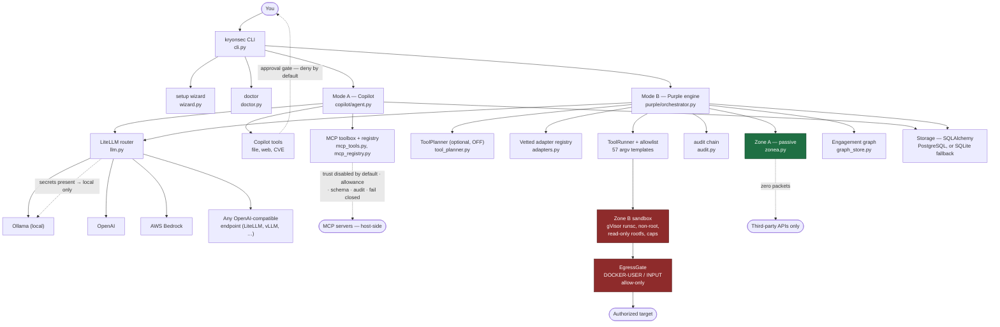
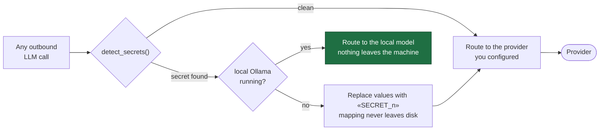
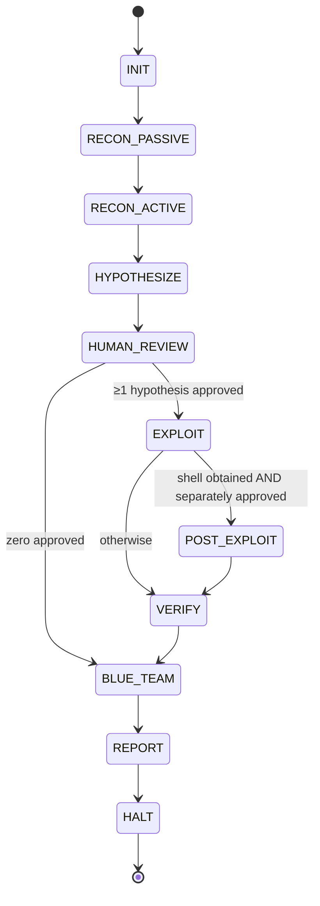
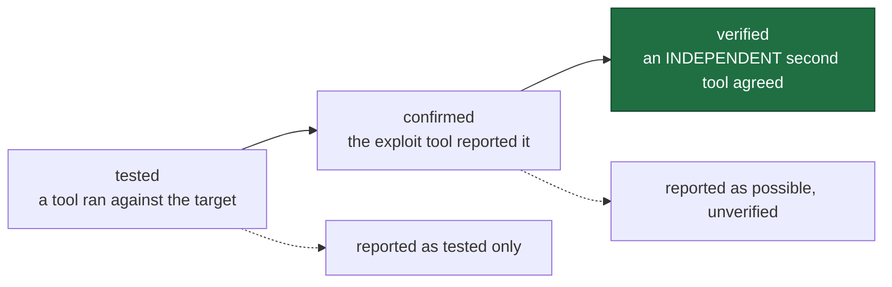
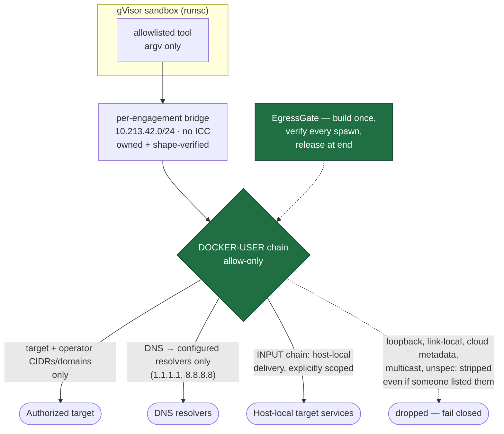
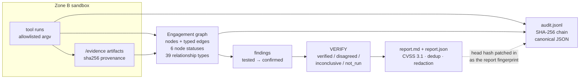

<div align="center">


# Kryonsec

**Everyone is building now. Who's securing it?**

A single-user CLI security platform with two modes: an AI copilot you can talk to,
and a deterministic purple-team engine that finds, tests and proves.

[](https://www.python.org/)
[](CHANGELOG.md)
[](LICENSE)
[](#testing-and-validation)
[-lightgrey)](#requirements)

[Install](#install) · [Copilot mode](#mode-a--general-copilot) · [Purple Team mode](#mode-b--purple-team) · [AWS Bedrock](#aws-bedrock) · [OpenAI-compatible endpoints](#openai-compatible-endpoints) · [Security design](#security-design-and-threat-model) · [Repository structure](#repository-structure)

<a href="https://youtu.be/ZnH-U8DG3Y0">
  
</a>

### ▶️ [Watch the demo](https://youtu.be/ZnH-U8DG3Y0)

</div>

---

## Table of contents

**The story**

1. [Everyone is building. Who's securing it?](#everyone-is-building-whos-securing-it)
2. [Why I built it](#why-i-built-it)
3. [The rule that shaped everything](#the-rule-that-shaped-everything)

**What it is**

4. [What Kryonsec is](#what-kryonsec-is)
5. [Features and current capabilities](#features-and-current-capabilities)
6. [Architecture](#architecture)

**Mode A — General Copilot**

7. [Mode A — General Copilot](#mode-a--general-copilot)
8. [MCP integration and tool authorization](#mcp-integration-and-tool-authorization)
9. [The secrets gate](#the-secrets-gate)
10. [LLM providers](#llm-providers) — [AWS Bedrock](#aws-bedrock) · [OpenAI-compatible endpoints](#openai-compatible-endpoints)

**Mode B — Purple Team**

11. [Mode B — Purple Team](#mode-b--purple-team)
12. [The 10-state loop and the two human gates](#the-10-state-loop-and-the-two-human-gates)
13. [Zone A — passive reconnaissance](#zone-a--passive-reconnaissance)
14. [Zone B — active assessment and the egress boundary](#zone-b--active-assessment-and-the-egress-boundary)
15. [Security-tool inventory](#security-tool-inventory)
16. [Nuclei template policy](#nuclei-template-policy)
17. [TLS and API assessment](#tls-and-api-assessment)
18. [Deterministic tool planning](#deterministic-tool-planning)
19. [Errors, retries and progress](#errors-retries-and-progress)
20. [Evidence, verification and reporting](#evidence-verification-and-reporting)

**Using it**

21. [Requirements](#requirements)
22. [Install](#install)
23. [First-run setup wizard](#first-run-setup-wizard)
24. [Usage reference](#usage-reference)
25. [Memory browser](#memory-browser)
26. [Configuration reference](#configuration-reference)
27. [Storage schema](#storage-schema)

**The honest parts**

28. [What broke along the way](#what-broke-along-the-way)
29. [What I learned](#what-i-learned)
30. [Current status](#current-status)
31. [Testing and validation](#testing-and-validation)
32. [Known limitations and roadmap](#known-limitations-and-roadmap)

**Reference**

33. [Security design and threat model](#security-design-and-threat-model)
34. [Technology stack](#technology-stack)
35. [Repository structure](#repository-structure)
36. [Release and versioning](#release-and-versioning)
37. [Development](#development)
38. [Credits and license](#credits-and-license)

---

## Everyone is building. Who's securing it?

I'm a cybersecurity researcher. I do bug bounties, I vibe-code a lot, and I love hackathons.

One day I was reading about a startup that got hit really badly because of security
vulnerabilities in their product. And I started thinking.

Everyone is building software now. But not everyone has a security team.

A solo developer isn't hiring a red team. A small startup doesn't have the budget for
security researchers. And AI just made building things dramatically easier — so we're
creating faster than ever, while security still feels like something you bring in *later*.

That didn't make sense to me.

So I thought: why don't I try to build the security team instead?

That's how Kryonsec started. It's my attempt to make security more accessible to
developers, startups and builders who can't just hire a whole team. I wanted something
that looks at a product the way a security researcher would — find things, investigate
them, and help figure out what *actually* matters.

---

## Why I built it

There's a version of this that's just:

```
AI + security tools = done
```

I didn't want to build that. I've tested enough AI systems to know they can be really
smart and still make really stupid mistakes.

So I did not want to hand an LLM unlimited access to a target and say *"bro, go hack
this."* 💀

Two decisions came out of that, and they shaped the whole project:

**1. Human approval sits in the workflow.** When Kryonsec finds a possible attack, it
stops and asks me before doing anything risky. That part matters a lot to me. In
cybersecurity, one wrong decision can become a very expensive problem.

**2. It follows how I actually work.** I've done a lot of bug bounty work, so I have my
own habits around recon — connecting clues, following a thread, figuring out where to go
next. Kryonsec is me trying to turn some of those habits into something repeatable. Not
just "call a tool and print the output," but a real workflow behind it.

That workflow is the part I'm most proud of.

> A good chunk of this got built during **First Commit**, which is also where AWS Bedrock
> made me suffer. 😭 More on that [below](#what-broke-along-the-way).

Kryonsec is live at **[kryonsec.in](https://kryonsec.in)**.

---

## The rule that shaped everything

> ### The LLM is creative, so the system around it must be rigid.

I trust the model to *think*. I don't trust it to *decide what happens next*.

Everything in this project follows from that one sentence:

- **No LLM-driven state transitions.** The orchestrator is plain Python. The model
  proposes; the loop decides.
- **Tool calls are argv lists, never shell strings.** There is no `shell=True` anywhere
  in the tool path.
- **Allowlists, not blocklists.** A tool is rejected unless it matches a per-tool
  template exactly.
- **Secrets never leave the machine by default.** Redacted or routed locally, before any
  third-party call.

The LLM is allowed to be creative in exactly two places: proposing hypotheses, and writing
remediation advice. Everywhere else, the answer is a lookup table.

---

## What Kryonsec is

A **dual-mode CLI for one operator** — you. Not a framework, not a multi-user SaaS. It's
a tool you install on your machine, talk to in a terminal, and — *when you have written
authorization* — point at a target.

The two modes are built on deliberately opposite philosophies:

| | **Mode A — General Copilot** | **Mode B — Purple Team** |
|---|---|---|
| What it is | A conversational security assistant with real tools (LLM function-calling) | A penetration-testing engine with a fixed 10-state loop |
| Who decides | The LLM decides *when* to call tools | **Plain Python** decides every state transition — the LLM only proposes |
| What it touches | Your files, the web, CVE databases, MCP servers | An authorized target, through a gVisor sandbox |
| Where it runs | Linux, WSL, macOS, Windows | **Linux/WSL2 only** — Docker + gVisor required, enforced by `kryonsec doctor` |
| Data visibility | Sanitized post-REPORT engagement summaries only — never raw evidence | Full engagement graph, evidence, and audit chain |

> **Design-of-record:** [`kryonsec-v2.1.1-dual-mode-architecture.md`](kryonsec-v2.1.1-dual-mode-architecture.md)
> is the authoritative spec. v2.1.0 and the fixes draft are kept in the repo for history.

Mode A's MCP toolbox stays **host-side** — a discovered MCP tool is never automatically
executable, and it can never reach Mode B execution. Only the Layer-2 argv allowlist and
the sandbox boundary can run a security tool, and only for an authorized engagement.

---

## Features and current capabilities

Legend: ✅ implemented and unit-tested · 🧪 implemented, verified against a real Docker +
gVisor host · ⚙️ implemented, requires a specific environment · 🚧 implemented but
feature-gated **OFF by default** · 💤 wired but dormant by design · 🗺️ planned ·
📦 release-ready, **not yet published**.

| Capability | Status |
|---|---|
| Copilot agent loop, file/web/CVE tools, slash commands | ✅ |
| MCP client + registry authorization (trust default `disabled`) | ✅ |
| Secrets gate: detect → redact/route-local, per LLM round | ✅ |
| LLM providers: Ollama, OpenAI, AWS Bedrock, OpenAI-compatible | ✅ |
| Full-screen terminal workspace (tabs, palette, approval panels) | ✅ |
| Read-only loopback memory browser | ✅ |
| Installer + first-run wizard + `kryonsec doctor` | ✅ |
| Digest-pinned sandbox image (installer resolves and persists the digest) | ✅ |
| Storage: PostgreSQL system of record, SQLite Copilot fallback, Fernet secrets | ✅ |
| Purple 10-state orchestrator (plain Python, HALT terminal) | ✅ |
| SHA-256-chained audit chain (canonical JSON, replayable verify) | ✅ |
| Allowlist: 57 argv templates across 5 stage groups | ✅ |
| Zone A passive recon — 10 third-party sources, zero packets to target | ✅ |
| Enrichment: NVD, CISA KEV, EPSS, OSV, GHSA (+ sandbox-local searchsploit/nuclei-meta) | ✅ |
| Evidence graph + per-state durable checkpoints | ✅ |
| Independent VERIFY (boolean SQLi probe through the sandbox) | ⚙️ needs sandbox |
| Blue-team code scanners (`--code`, read-only mount) | ⚙️ needs sandbox |
| Vetted web adapters (httpx/whatweb/tls/api/searchsploit-term/nuclei probes) | 🧪 12/12 lab IT |
| Batch 1 adapter probes (naabu/dnsx/katana) — same sandbox+allowlist path | 🧪 mocked suites green; lab ITs armed, not run |
| Batch 2 adapter probes (nmap/feroxbuster/gowitness) — same sandbox+allowlist path | 🧪 mocked suites green; lab ITs armed, not run |
| Nuclei hash-pinned template manifest + sandbox-side gate (2B.8) | 🧪 enforced, fail-closed |
| Zone B egress boundary (per-engagement bridge, DOCKER-USER/INPUT allow-only) | ⚙️ needs Docker host + `sudo -n` helper |
| Deterministic tool planner (2B.6) | 🚧 OFF unless enabled |
| POST_EXPLOIT state + Gate 3 machinery | 💤 dormant — no capability parser or shell producer registered |
| Streaming LLM responses | 🗺️ planned (nothing consumes a stream yet) |
| WORM anchoring of the audit head | 🗺️ planned (report-printed anchor only) |
| Redis cache / MinIO evidence objects | 🗺️ planned (spec only) |
| Phase 3 multi-agent intelligence, Phase 4 exploit verification | 🗺️ planned |
| **v1.3.11** (nuclei manifest, TLS/API adapters, honest failures) | 📦 preflight complete, **not published** |

The version badge tracks the **source version** (1.3.11). The latest **published**
release is v1.3.10 (2026-11-10) — see [Release and versioning](#release-and-versioning).

---

## Architecture



**The short version:** the CLI is a thin shell over two engines. Both talk to LLMs through
one router that enforces the secrets gate. Only Mode B is allowed to touch a target, and
only through the gVisor sandbox, only with an allowlisted argv behind a vetted adapter or
a fixed plan, only inside an egress boundary that allows just the target scope, and only
with every spawn written to a hash-chained audit log.

---

## Mode A — General Copilot

```bash
kryonsec                  # start the chat
kryonsec doctor           # preflight checks
kryonsec doctor --deep    # harmless network-disabled runsc smoke test
kryonsec doctor --deep --strict  # require the full Purple runtime
kryonsec setup            # re-run the wizard
kryonsec memory           # browse saved engagement memory (read-only)
```

### The agent

The copilot is a real tool-using agent (LLM function-calling), not a chat wrapper. It decides
when to call tools, up to 8 tool rounds per answer, then must produce text. You see every tool
call as it happens:

```
[COPILOT]> is CVE-2024-3094 relevant to my nginx setup?
  └─ cve_lookup(cve_id=CVE-2024-3094)
  └─ file_read(path=/etc/nginx/nginx.conf)
Yes — here's what matters for your config...
```

Built-in tools the agent can call (only the ones you enabled in setup):

| Tool | What it does |
|---|---|
| `file_read` | read a file — **approval-gated** outside `~/kryonsec/workspace` |
| `file_write` | write a file — **approval-gated** outside the workspace |
| `list_dir` | list a directory — **approval-gated** outside the workspace |
| `web_search` | keyless multi-engine web search, results enter chat context |
| `cve_lookup` | NVD CVE lookup (`services.nvd.nist.gov`), cached locally for offline reuse |

Every file action outside the workspace shows a yellow approval panel — why the agent wants
the file, and Approve/Deny. **Deny is the default (Enter = Deny).** Approving for *this
session only* vs *once* is a separate choice, so a one-off approval never turns silent.

`cve_lookup` talks to the NVD only. The richer CVE context (CISA KEV, EPSS, OSV, GitHub
Advisories) lives in Mode B's enrichment stage — Mode A stays a general assistant and
cannot see engagement data.

### Slash commands

| Command | What it does |
|---|---|
| `/cve CVE-2024-1234` | CVE lookup from NVD, cached offline |
| `/search <query>` | web search — results go into context |
| `/read <path>` | read a file (approval-gated outside workspace) |
| `/ls <path>` | list a directory (approval-gated outside workspace) |
| `/write <path>` | write text to a file in the workspace |
| `/workspace` | show the workspace path |
| `/mode` | switch copilot ⇄ purple mode — or press **Shift+Tab** |
| `/theme <name>` | saves a theme preference for other Kryonsec surfaces (the workspace always uses the mode-driven monochrome palette) |
| `/help` | command reference |
| `/quit` (`exit`, `quit`, `q`) | leave — session is persisted |

### Terminal workspace and shortcuts

The interactive terminal is one persistent full-screen workspace. The top bar
shows real saved session or engagement tabs, the centre holds the conversation
or engagement dashboard, the right sidebar shows live context, provider/model,
MCP status, runtime, and (in Mode B) the eight security agents, and the
composer stays anchored at the bottom. On terminals narrower than 100 columns
the sidebar collapses so the workspace keeps its space. In Mode B the sidebar
is driven by real runtime state — Docker and sandbox availability come from
the same checks the engagement gates use (shown as `unknown` before they run),
the agents panel follows live events, and a dedicated Tool · Command section
shows the active tool with its actual argv (redacted, never constructed by the
UI). The Mode B centre shows a 10-state workflow timeline with stage
durations, a timestamped live activity stream, and a current-operation block
for the running agent.

| Shortcut | Action |
|---|---|
| **Enter / Shift+Enter** | send / insert a newline |
| **Shift+Tab** | switch Copilot/Purple when the existing sandbox and license checks allow it |
| **Ctrl+P** | open the command palette (also: Rename session, Close session, Open Kryonsec Memory) |
| **Ctrl+N** | create a real new session or engagement |
| **Ctrl+Left / Ctrl+Right** | move between stored tabs |
| **Ctrl+R** | rename the active Copilot session (prepopulated dialog; Esc cancels) |
| **Ctrl+W** | close the active tab (refused while an operation or approval is pending; stored history is kept) |
| **Ctrl+Q** | leave (sessions are saved) |
| **Ctrl+C** | stop the active operation at a safe boundary, or leave when idle |

The workspace palette is mode-driven: Mode A (Copilot) renders entirely in
black, white, and gray with state carried by text marks (✓ ○ ! …); Mode B adds
purple only on the KRYONSEC wordmark. In Mode B the right sidebar also carries
a focusable **Kryonsec Memory** entry (or `Open Kryonsec Memory` in the
palette) that launches the existing read-only loopback memory browser on
demand — it never opens on startup or on a mode switch. The `/theme` command
still saves a preference for other Kryonsec surfaces, but it cannot change the
workspace palette.

Closing a tab is never an approval and never cancels backend work: while a
tool call, sandbox run, or any approval gate is active, tab closing is
refused. Renaming a Copilot session changes only the display title (persisted
across restarts); engagement identifiers stay immutable.

Theme choices are presentation-only and are saved separately in
`~/.kryonsec/ui.json` for the non-workspace surfaces; the full-screen
workspace itself always uses the mode-driven monochrome palette. Built-ins
are `kryonsec`, `tokyonight`, and `dracula`; use `/theme` to switch the saved
preference. Piped, CI, and legacy terminals keep plain output
without full-screen escape sequences. See `docs/screenshots/` for headless
captures of the real app.

### Memory

- **Session STM:** messages are kept and compacted when they exceed 80% of the token budget.
  Compaction runs with secrets redacted, and a broken compaction model skips itself rather
  than killing your chat mid-turn.
- **Long-term memory:** after each exchange, a background pass extracts durable facts about you
  (role, preferences, ongoing projects) into `general_user_ltm` — best-effort by design; memory
  failure never breaks the chat.
- **Long-term memory is isolated:** the copilot can see *sanitized post-REPORT engagement
  summaries* only. It never sees raw evidence, credentials, or live engagement data.

### Web search

`/search` (and the agent's `web_search` tool) tries five keyless sources in order —
DuckDuckGo html/lite/API, Mojeek, Wikipedia — so it keeps working when one engine
bot-challenges your network. Results are cached for a day.

---

## MCP integration and tool authorization

Copilot is an MCP client. During setup you can enable servers (stdio transport, one subprocess
per server, connected once per session — not per message):

| Preset | Command | Notes |
|---|---|---|
| `fetch` | `uvx mcp-server-fetch` | fetch web pages as clean text, no API key |
| `filesystem` | `npx -y @modelcontextprotocol/server-filesystem` | needs Node; wizard asks for the allowed directory |
| `docsafe` | shipped with Kryonsec | read-only document reader, **disabled until you add the `[[mcp.servers]]` row yourself** |

`uvx` comes with [uv](https://docs.astral.sh/uv/) and `npx` with [Node.js](https://nodejs.org/).
The installers put uv into kryonsec's own venv so the `fetch` preset works on a fresh machine;
Node is not installed for you — setup warns if it is missing, and names what to install.

You can also add any custom stdio MCP server (name + command + env).

**Discovery is not execution.** A connected server exposes its tools for *search and
inspection* — the agent can see what exists, but the only route that actually runs a
third-party tool is `McpRegistry.call_mcp_tool`, and every decision on that path is
audited and fails closed:

1. **Trust policy** — `disabled` (default) | `ask` | `allow`, per server. A freshly
   connected server exposes **zero callable tools** until you raise trust.
2. **Tool allowance** — even a trusted server only runs the tools you listed
   (`allow_tools`), never everything it advertises.
3. **Human approval** — `ask`-level servers prompt per tool; **a non-interactive
   session cannot grant trust** (no TTY approves nothing).
4. **Schema validation** — arguments are validated against the tool's own JSON schema
   (nested objects, arrays, enums, size/depth caps). Schema validity is *not*
   authorization — destination and path-scope guards run separately.
5. **Concurrency bound** — calls are capped (default small, max 8); a hung worker beyond
   2× the cap is refused, so queues can't grow without bound.
6. **Redaction and framing** — results are secret-redacted, size-bounded, and stamped as
   **untrusted third-party data** before they enter the conversation. A server that
   *claims* to be sandboxed is not believed.

The agent only ever sees **five** registry tools: `list_mcp_connections`,
`search_mcp_tools`, `get_mcp_tool_schema`, `describe_mcp_connection`, `call_mcp_tool`.
Everything else a server advertises stays behind the registry.

**Scope boundary:** all of this is host-side. No MCP connection can reach Mode B
execution — the Purple engine runs only allowlisted argv inside the gVisor sandbox, and
a remote MCP "run this command for me" server is never a substitute for that boundary.

Every MCP tool call is appended to its own SHA-256-chained audit log
(`~/.kryonsec/audit_mcp.jsonl`), the same canonical-JSON hashing as the engagement chain.

---

## The secrets gate

This is the flow every outbound LLM call goes through:



- **The gate re-runs before *every* LLM round**, not once per session — because a tool result
  can introduce a secret mid-conversation.
- **Eleven secret shapes** are detected: private key blocks, JWTs, bearer tokens, AWS access
  keys, GitHub tokens, OpenAI keys, Slack tokens, Google API keys, password/key assignments,
  generic `api_key =` assignments, and connection strings.
- **The model cannot skip redaction.** Any hosted call must carry a
  `SECRET-PATTERNS-REDACTED: n` declaration, and the count is verified — a mismatch refuses
  the call.
- **Compaction is stricter.** With secrets present, compaction is local-only and refuses
  outright (`CompactionMustStayLocal`) rather than using a hosted model.
- **Password and key labels survive redaction** — `password: «SECRET_1»` stays readable, so
  summaries still make sense.
- **Engagement data, credentials, and raw evidence are never sent to third-party LLMs.**

---

## LLM providers

All LLM calls route through **LiteLLM** (`litellm.completion`) with a provider choice that is
**exclusive** — an Ollama config never calls a hosted API, and an OpenAI or Bedrock config never
silently falls back to a different provider. The only exception is the local model, and only
for the secrets gate.

1. **Ollama (local, preferred):** `ollama serve` + `ollama pull llama3.1` — nothing leaves your machine
2. **OpenAI:** API key from the wizard or `OPENAI_API_KEY` — never used for compaction when secrets are present
3. **AWS Bedrock:** see [the Bedrock section](#aws-bedrock) below
4. **OpenAI-compatible:** any server speaking the OpenAI protocol — see
   [the OpenAI-compatible section](#openai-compatible-endpoints) below

There is **no streaming** anywhere in the LLM path yet: nothing consumes a stream, so no
provider feature assumes one. Tool calling goes out in the standard OpenAI `tools` format
and comes back through the same abstraction for every provider; the provider only talks to
the model and never executes anything.

### AWS Bedrock

This was the hardest thing to get working, so it gets its own section. 😭

Kryonsec supports **four providers** — Ollama (local, preferred), OpenAI, AWS
Bedrock, and any OpenAI-compatible endpoint. Bedrock is not bolted on as an afterthought;
it goes through the same secrets gate as everything else, which means **your secrets are
never sent to Bedrock either**, because Bedrock is a third party like any other.

```toml
[llm]
provider = "bedrock"
bedrock_api_key = "ABSK..."                              # or AWS_BEARER_TOKEN_BEDROCK
bedrock_region = "us-east-1"                             # detected by the wizard
chat_model = "bedrock/us.anthropic.claude-sonnet-4-5-20250929-v1:0"
```

Three things make this trickier than it looks, and each one is handled:

**1. A Bedrock API key has no region.** It's a bearer token — there's no region baked into
it, and the SigV4 access-key/secret-key/instance-profile route isn't used at all. So the
wizard **probes the AWS regions with your key** and remembers the one that accepts it.
That probe doubles as the key check.

**2. Model IDs stay in Bedrock form everywhere.** A model id carries a `bedrock/` prefix —
`bedrock/us.anthropic.claude-sonnet-4-5-20250929-v1:0` — and that's the form you see in
config, in the wizard, and in logs. At the moment of the call, Kryonsec translates it into
an OpenAI-compatible request against
`https://bedrock-runtime.<region>.amazonaws.com/openai/v1`, authenticated with your key as
a bearer token.

**3. Listing a model doesn't mean it answers.** Bedrock's OpenAI-compatible endpoint serves
a *subset* of the catalog. So a model that shows up in `kryonsec setup` can still refuse a
call. The wizard therefore **checks that the model actually answers before it saves the
config** — and it puts cross-region inference profiles first, because newer Claude models
only work through those.

The key is never logged and never placed in an error message.

> Bedrock fighting me for an entire hackathon is genuinely where I learned the most,
> because I wasn't reading about it — I was trying to make it work inside something real.

### OpenAI-compatible endpoints

Kryonsec also speaks the **OpenAI Chat Completions protocol** to any endpoint you point
it at. That one provider covers LiteLLM, vLLM, llama.cpp's server, LM Studio, LocalAI,
OpenRouter, Ollama's own `/v1` route, or a gateway someone stood up this morning — because
the *protocol* is the integration, not a vendor. There is no list of supported products to
keep current, and no branch anywhere that keys off a hostname, a port or a model name.

```toml
[llm]
provider = "openai_compatible"
base_url = "<BASE_URL>"        # e.g. https://<HOST>/v1 — include the /v1 path if your server uses one
api_key  = "<API_KEY>"         # optional: blank for a server that needs none
chat_model = "<MODEL_NAME>"    # exactly as your server spells it
```

`model` is accepted as an alias for `chat_model` in the file. What you type is what gets
sent — kryonsec never substitutes a model name of its own. There is no default model for
this provider: the defaults that exist belong to the Ollama and OpenAI seats, so inheriting
one here would send your chat somewhere you did not configure. A config that selects this
provider without naming a model is reported as incomplete (`kryonsec doctor`) rather than
quietly running against a different provider.

The name is opaque to Kryonsec: anything your server answers to works, including
OpenRouter-style `vendor/model` ids such as `openai/gpt-oss-120b` or `meta-llama/llama-3.1-70b`
— those reach your endpoint exactly as typed, and are never sent to `api.openai.com`. There
is no model allowlist, and `/models` is never consulted to decide whether a model is allowed
to run; it only offers a list to pick from, and a server that does not implement it is
perfectly fine. Two prefixes stay reserved, because they name other services rather than
models: `ollama/` (the local model the secrets gate falls back to) and `bedrock/`.

**Connecting a local server.** Run your server, note the host and port *it* chose, and give
the wizard that URL. If your server mounts its API under `/v1`, include it; kryonsec appends
nothing and guesses nothing, so the path you configure is the path that is called. A local
server usually wants no API key — leave that blank and no `Authorization` header is sent at
all.

**Connecting LiteLLM.** LiteLLM's proxy is an OpenAI-compatible server, so it is configured
exactly like any other: its base URL (which is where *your* LiteLLM instance listens, not a
value baked in here), its key if it has one, and whichever model name your LiteLLM config
exposes. No code change — that is the point.

**Model support is not assumed.** When you finish setup the wizard probes the endpoint and
reports what it actually answered:

```text
  connection            yes
  model response        yes
  tool calling          yes / no / unknown
  server streaming      yes / no / unknown
  kryonsec streaming    unimplemented
```

`unknown` is a real answer, not a missing one. A server accepting the `tools` parameter does
not prove the model will use tools, and a model that replies in plain text to a tool-shaped
prompt has told us nothing — so those report `unknown` rather than a `no` that would read as
"broken". A `no` means the endpoint refused the parameter outright.

Those rows describe the **endpoint**, not Kryonsec. `server streaming` is what your server
accepts; `kryonsec streaming` is what Kryonsec can currently consume, and it cannot consume a
stream yet — so a `yes` above is your server's capability, never a claim about a Kryonsec
feature. A probe that fails blocks nothing: the result is reported and the configuration is
kept, because an endpoint that will not answer a test message may still serve the model.

**Tool calling.** Kryonsec's tool definitions go out in the standard OpenAI `tools` format
and tool calls come back through the same abstraction the other providers use. The provider
only talks to the model — it never executes anything. Whether a tool call is allowed, how it
runs, and what gets logged stays with the orchestrator, exactly as before. Your endpoint's
model needs to support tool calling for the agent loop to be useful; the probe tells you.

**Security.** The key is stored in `config.toml` with owner-only permissions, never logged,
and never echoed back in an error message. One subtlety worth knowing: Kryonsec does **not**
let a keyless endpoint fall back to an `OPENAI_API_KEY` sitting in your environment — for a
local server the header is sent empty rather than shipping your real OpenAI credential to a
machine that has no business seeing it.

---

## Requirements

| Component | Copilot (Mode A) | Purple Team (Mode B) |
|---|---|---|
| Python 3.11+ | ✅ | ✅ |
| Linux / WSL2 | optional | ✅ required (gVisor) |
| Docker | — | ✅ required |
| [gVisor](https://github.com/google/gvisor) `runsc` runtime | — | ✅ required |
| Pinned `kryonsec/sandbox` image | — | ✅ required (pulled by installer) |
| Ollama (local LLM) | optional (recommended) | optional (recommended) |
| OpenAI API key | optional | optional |
| AWS Bedrock API key | optional | optional |
| OpenAI-compatible endpoint URL | optional | optional |
| PostgreSQL | optional (SQLite fallback) | optional (SQLite fallback) |

`kryonsec doctor` checks all of this and refuses to start Purple Team if anything is missing.
The supported Purple release path is Linux x86-64 (native Linux or WSL2 with a native
Linux Docker Engine). Docker Desktop's selected daemon cannot host a `runsc` runtime.
The installer never switches contexts or changes Docker's default runtime. See
[`docs/INSTALLATION.md`](docs/INSTALLATION.md) for the full support matrix.

Mode B is **not** release-supported on macOS or Linux ARM64 (the published sandbox tool
set contains x86-64-only artifacts). Copilot runs anywhere Python 3.11–3.13 does.

---

## Install

Kryonsec is commercial, proprietary-licensed software. The source in this repository is
public for review, but the **supported distribution is a built wheel served from
[kryonsec.in](https://kryonsec.in)**, and a membership key is what unlocks it — the
installer downloads a version-matched wheel, verifies its SHA-256, and never treats the
GitHub tree as a distribution channel. [Request access](https://kryonsec.in) to get a key.

### Linux or WSL2

```bash
curl -fsSL https://kryonsec.in/install.sh -o install.sh
KRYONSEC_KEY=KRYO-XXXX-XXXX-XXXX bash install.sh --profile=auto
```

The installer first installs the Copilot environment. Its `auto` profile asks before
attempting the optional Purple Team host changes; `copilot` never touches Docker, and
`purple` fails unless the strict isolated path is ready:

```bash
bash install.sh --dry-run --profile=auto
bash install.sh --profile=copilot   # no Docker/service changes
bash install.sh --profile=auto      # ask before optional Purple setup
bash install.sh --profile=purple    # require Purple and deep preflight
```

It then:

1. Checks for required download tools (`curl`) and stops with a repair command if they are missing
2. Checks for Python 3.11+ (tries `python3.13`, `python3.12`, `python3.11`, then a bare
   `python3` — and warns if the only one present is a very new 3.14, where pip may have to
   compile dependencies from source and the install looks stalled)
3. Creates a dedicated virtualenv at `~/.kryonsec/venv`
4. Downloads the release from `kryonsec.in` with your key, and saves that key to
   `~/.kryonsec/config.toml` so Purple Team never asks for it again
5. Adds `~/.kryonsec/venv/bin` to your `PATH` (in `.bashrc`, idempotent)
6. On the approved Purple profile, validates the selected Docker context and daemon,
   installs/registers gVisor only after consent, backs up and validates Docker JSON before
   any approved restart, and never uses root Docker probes
7. **Pulls the release-matched sandbox image and pins its digest**: the resolved
   `RepoDigests[0]` is verified and written into `config.toml` as
   `kryonsec/sandbox@sha256:<digest>` — a mutable tag is never accepted as the Purple
   runtime image, and a local or digest-less image fails the profile
8. Runs `kryonsec setup` — the first-run wizard
9. Runs `kryonsec doctor`; `--deep --strict` is used for a requested Purple profile

On **Omarchy / Arch Linux** the same installer works: it is distro-agnostic where it can
be (it uses whatever `python3.11+` and `curl` you have) and only reaches for `apt-get`
on Debian/Ubuntu-shaped systems to install gVisor. On Arch, install gVisor yourself
(`pacman -S gvisor-bin` or the [official runsc binary](https://gvisor.dev/docs/user_guide/install/))
and register it with Docker (`/etc/docker/daemon.json` → `"runtimes": {"runsc": {"path": "runsc"}}`),
then run the installer with `--profile=purple` and let `kryonsec doctor` confirm.

To install Copilot only and prepare Purple later:

```bash
KRYONSEC_KEY=KRYO-XXXX-XXXX-XXXX bash install.sh --profile=copilot
# later, after choosing and configuring the Linux daemon:
bash install.sh --profile=purple
```

Installer environment variables:

| Variable | Effect |
|---|---|
| `KRYONSEC_KEY` | Your membership key. Unlocks the download without browser approval. |
| `KRYONSEC_LICENSE_KEY` | The same key, under the name the app itself reads |
| `KRYONSEC_DOWNLOAD_URL` | A one-time download link prepared by the site (the Unix dashboard command) |
| `KRYONSEC_WHEEL` | Install a specific wheel instead of downloading — a path or URL. For air-gapped machines and support hand-offs. |
| `KRYONSEC_SITE` | Base URL to download from (default `https://kryonsec.in`) |
| `KRYONSEC_SANDBOX_IMAGE` | Override the image ref the installer pulls; may carry a `@sha256:<digest>` |
| `KRYONSEC_REGISTRY_TOKEN` | GHCR token — only needed if the sandbox image is private (`read:packages`) |
| `KRYONSEC_REGISTRY_USER` | Username for that token (default `kryonsec`) |
| `KRYONSEC_SKIP_SANDBOX=1` | Skip the image fetch entirely |
| `KRYONSEC_PROFILE` | `auto`, `copilot`, or `purple` |
| `KRYONSEC_DRY_RUN=1` | Read-only installer plan |
| `KRYONSEC_REPAIR=1` | Preserve and repair an incomplete installer-owned venv |
| `KRYONSEC_WHEEL_SHA256` | Expected SHA-256 for a local wheel override |
| `KRYONSEC_HOME` | Install location (default `~/.kryonsec`) |

### Windows (PowerShell)

```powershell
irm https://kryonsec.in/install.ps1 -OutFile "$env:TEMP\kryonsec-install.ps1"
powershell -ExecutionPolicy Bypass -File "$env:TEMP\kryonsec-install.ps1"
```

That command is short and carries no credential. For a beta account, the
installer shows an approval link, opens it in the browser, and waits for a
signed-in, entitled member to approve the machine. Approval yields a fresh,
single-use download link, and the wheel's SHA-256 is checked before anything
is installed.

A membership key still works without browser approval: set `KRYONSEC_KEY`
(or `KRYONSEC_LICENSE_KEY`) before running the second line. `-DryRun` prints
the plan; `-Repair` preserves an incomplete virtualenv before replacing it.
`-ExecutionPolicy Bypass` applies to that one process only; a freshly
downloaded script is blocked outright under the Windows client default policy.

Windows gets Copilot mode only. Purple Team is gated behind a runtime check and must never
run on the Windows host. Use WSL2 with a native Linux Docker Engine for Mode B.

### From source (development)

The repository is public, but the supported install is the release wheel — the source
tree is for development and review:

```bash
pip install -e ".[dev]"
kryonsec setup
```

---

## First-run setup wizard

The first launch without a config starts the wizard automatically (re-run anytime with
`kryonsec setup`). It walks you through:

1. **Pick your LLM provider** — OpenAI, Ollama (local), AWS Bedrock, or an OpenAI-compatible endpoint
2. **Provider setup**
   - *OpenAI:* paste your API key → tested live → pick a model from the list (most recent first)
   - *Ollama:* pick from your already-pulled local models
   - *AWS Bedrock:* paste a Bedrock API key (starts with `ABSK`) → the wizard prints how to
     create one, **auto-detects your region**, then lists models with cross-region inference
     profiles first — and verifies the model actually answers before saving
   - *OpenAI-compatible:* give it the base URL, an optional key, and the model name — then it
     probes the endpoint and reports connection, model response, tool calling and streaming
3. **Pick the built-in agent tools** (space to select, enter to continue)
4. **Pick MCP servers** — presets or add your own (see [MCP integration](#mcp-integration-and-tool-authorization))
5. **A summary screen** of everything you chose

The wizard writes `~/.kryonsec/config.toml` with **owner-only permissions** — that file holds
your API key. Environment variables still override the file for power users and CI.

---

## Usage reference

Every command and flag below is taken from `argparse` in `src/kryonsec/cli.py` — there
are no nested subcommands and no hidden flags.

| Command | Flags | What it does |
|---|---|---|
| `kryonsec` | — | starts the interactive CLI (Copilot chat); first run launches the wizard |
| `kryonsec --version` | — | prints `kryonsec 1.3.11` |
| `kryonsec setup` | — | re-runs the setup wizard |
| `kryonsec doctor` | `--deep`, `--strict` | read-only preflight checks; `--deep` adds a harmless network-disabled runsc smoke container; `--strict` exits non-zero unless Copilot *and* the verified Purple runtime are ready |
| `kryonsec connect` | `--no-browser` | register this machine to your membership (opens a browser once) |
| `kryonsec login` | `--no-browser` | sign in to a beta account (opens a browser once; no key needed) |
| `kryonsec logout` | — | revoke this machine's token, then delete it locally |
| `kryonsec auth [status]` | — | show how this machine is signed in (`status` is the only value) |
| `kryonsec purple` | `--target` (required), `--id`, `--code FOLDER` | start a Purple Team engagement (Profile 2, Linux only); `--code` mounts a source folder read-only for the blue-team scanners |
| `kryonsec memory` | `--host` (loopback-only), `--port` (default 8899), `--no-browser` | serve the read-only engagement-memory browser |

Exit codes worth knowing: `kryonsec purple` returns **2** for an invalid target or
`--code` folder and **3** when the membership/license gate refuses Mode B (Copilot stays
unaffected). `kryonsec memory` returns **2** and a clear message if you try to bind a
non-loopback host — there is no override; use an SSH tunnel instead.

```bash
# a Purple engagement against a target you are authorized to test:
kryonsec purple --target your-authorized-target.com
kryonsec purple --target your-authorized-target.com --id acme-q3
# blue-team code scanning of your own project (folder mounted read-only):
kryonsec purple --target your-authorized-target.com --code ~/src/my-app

# strict preflight for the full Purple runtime:
kryonsec doctor --deep --strict
```

> ⚠️ **Only run `purple` against systems you have written authorization to test.**
> The target is validated into a bare domain and scope-checked everywhere it is used.

For development and testing commands, see [Development](#development).

---

## Mode B — Purple Team

One command runs a full engagement:

```bash
kryonsec purple --target your-authorized-target.com
# or: kryonsec purple --target your-authorized-target.com --id my-engagement
# with blue-team code scanning (folder mounted read-only into the sandbox):
kryonsec purple --target your-authorized-target.com --code /path/to/source
```

Or switch inside the chat with `/mode` (or **Shift+Tab**), then type a domain.

Without a sandbox the engagement still runs — it stops after passive recon,
because Zone A works everywhere. With a sandbox missing *mid-loop*, a Zone B
state halts with an audited `zone_b_blocked` event instead of ever falling
back to host-side execution.

### The operations workspace

Purple Team uses the same terminal workspace language as Copilot: an
engagement header, honest workflow timeline, current operation, bounded tool
activity, findings/evidence standing, and a completion summary. Raw developer
logs are still kept in the engagement debug log rather than on the operator
screen.

The console learns everything from two streams that already existed — the orchestrator's state
callback and the audit chain, via a read-only `add_observer` — so **no subagent knows a UI
exists**. What you get:

- **Honest progress.** The old `20%` was the fraction of *states entered*, which reads as work
  completed. It now says `Stage 3 of 10`.
- **Tool activity as it happens.** Every tool shows its operator-facing name (`crt.sh`, not
  `crt_sh_subdomains`), what it does, how long it took, and its result. Completed tools stay as
  history; only tools that actually ran appear. Adapter failures surface as one redacted
  progress line each (see [Errors, retries and progress](#errors-retries-and-progress)).
- **Tracebacks are split, not shown.** One line per warning on the console; the full record,
  `exc_info` intact, goes to `engagements/<id>/debug.log`.
- **Human review is a proper Gate 2 panel** (`A`/`R`) and remains separate from
  the Gate 3 post-exploitation approval.
- **Piped and CI runs stay observable** — with no TTY it prints one line per state.

### End of engagement

The summary screen gives you a one-line verdict first (halted / verified findings /
possible-but-unverified / nothing confirmed), then the evidence: subdomains found, hypotheses
with confidence scores, tool runs with exit codes, findings with their verified status, the
audit chain head, and the report path (`~/.kryonsec/engagements/<id>/report.md`).

---

## The 10-state loop and the two human gates

Ten loop states, plus the terminal `HALT`. Each state has one job, and **none of them choose
what runs next** — they return a `SubagentResult` and the orchestrator looks up the
transition in a plain-Python dict.



The whole transition table, verbatim from `purple/orchestrator.py`:

| From | To | Condition |
|---|---|---|
| `INIT` | `RECON_PASSIVE` | always |
| `RECON_PASSIVE` | `RECON_ACTIVE` | always |
| `RECON_ACTIVE` | `HYPOTHESIZE` | always |
| `HYPOTHESIZE` | `HUMAN_REVIEW` | always |
| `HUMAN_REVIEW` | `EXPLOIT` | `approved_count > 0` |
| `HUMAN_REVIEW` | `BLUE_TEAM` | zero approved |
| `EXPLOIT` | `POST_EXPLOIT` | `shell_obtained and post_exploit_approved` |
| `EXPLOIT` | `VERIFY` | otherwise |
| `POST_EXPLOIT` | `VERIFY` | always |
| `VERIFY` | `BLUE_TEAM` | always |
| `BLUE_TEAM` | `REPORT` | always |
| `REPORT` | `HALT` | always |
| any | `HALT` | `result.status == "halted"` |

Two details worth calling out:

- **Rejection is not a dead end.** If you reject every hypothesis, the engagement still
  routes through `BLUE_TEAM` — you get defensive recommendations anyway. It never jumps
  straight to `REPORT`. That was a real fix (v2.1.1).
- **The budget guard halts the loop** when tokens, wall-clock, or cost run out. Defaults:
  100,000 tokens, 3,600 seconds, $5.00. The same guard refuses to leave `INIT` when the
  Purple Team prerequisites (Linux + Docker + gVisor) are missing.

### Every state in detail

| State | Purpose (input) | Agent | Tools / data sources | Output · audit | Next | Approval |
|---|---|---|---|---|---|---|
| `INIT` | Load config, validate the target into a bare in-scope domain, derive engagement id | init (deterministic) | none | validated scope + budget tracker · `engagement_created`, `state_enter` | `RECON_PASSIVE` | none — *authorization is yours*; an invalid target exits 2 before anything starts |
| `RECON_PASSIVE` | Third-party recon, **zero packets to the target** (Zone A) | passive-recon (deterministic) | crt.sh, Wayback CDX, OTX passive DNS, RIPEstat whois/ASN, RDAP (IANA bootstrap), HackerTarget; keyed: Shodan, Censys, GitHub; optional sandbox `subfinder/amass/assetfinder -passive` | subdomain/path/osint nodes + provenance edges · `passive_source_ok/failed/skipped` per source | `RECON_ACTIVE` | none |
| `RECON_ACTIVE` | Active scanning of in-scope assets only | active-recon (deterministic, planner optional) | fixed plan (nmap, naabu, dnsx, httpx, rustscan, whatweb, katana, hakrawler, feroxbuster, massdns, gowitness, sslscan, openapi_probe) **or** vetted adapters (httpx/whatweb/tls/api/nuclei/naabu/dnsx/nmap/katana/feroxbuster/gowitness probes) | service/endpoint/technology nodes, screenshots, evidence artifacts with sha256 · `tool_spawn/tool_result` | `HYPOTHESIZE` | none — sandbox availability is checked, else audited `zone_b_blocked` halt |
| `HYPOTHESIZE` | Propose vulnerability hypotheses from the graph | hypothesizer **(LLM)** | nothing touches the target; enrichment: NVD, CISA KEV, EPSS, OSV, GHSA (host-side), searchsploit + nuclei-meta (sandbox-local) | hypothesis nodes with confidence, CVSS vector, enrichment · `enrichment_lookup` events | `HUMAN_REVIEW` | none |
| `HUMAN_REVIEW` | **Blocking approval** of hypotheses | **you** | none | approved/rejected sets · every decision audited; **non-TTY approves nothing** | `EXPLOIT` if ≥1 approved, else `BLUE_TEAM` | **Gate 2** |
| `EXPLOIT` | Execute **approved hypotheses only** | exploit (deterministic, LLM parses output) | `EXPLOIT` allowlist (sqlmap, nuclei, ffuf, gobuster, wfuzz, dalfox, commix, ssrfmap, arjun, tplmap, nikto, …); every nuclei run needs per-hypothesis approval | exploit_attempt nodes, exit codes, evidence · `tool_spawn/tool_result`, `capability_recorded` | `POST_EXPLOIT` only if shell detected **and** separately approved; else `VERIFY` | Gate-2 approval per hypothesis (+ **Gate 3** if a shell is claimed) |
| `POST_EXPLOIT` | Post-exploitation collection | post-exploit (deterministic) | planned: linpeas.sh, pspy64, linux-exploit-suggester, baked enum scripts; impacket/bloodhound allowlisted but excluded | bounded `post_exploit_evidence` nodes · `post_exploit_capability_refused` on any irregular record | `VERIFY` | **Gate 3** — separate approval, distinct from Gate 2; **dormant today** (see below) |
| `VERIFY` | Independent confirmation of confirmed findings | verifier (deterministic) | curl boolean probes through the sandbox allowlist; secondary reachability probes never mark anything verified | `verify_attempt` nodes; `finding.verified = true` only on agreement · `finding_verified` | `BLUE_TEAM` | none |
| `BLUE_TEAM` | Defensive fixes, detection rules, code scanning | blue-team **(LLM)** + static scanners | semgrep, bandit, gitleaks, trivy, checkov, syft, osv-scanner, grype (+ hadolint if a Dockerfile exists) on the read-only `/code` mount | remediation + scanner_result nodes, SBOM summary | `REPORT` | none |
| `REPORT` | Write the deliverable | reporter (deterministic) | none — reads the graph and audit chain | `report.md` + deterministic `report.json` · `report_written`, head-hash fingerprint | `HALT` | none |
| `HALT` | Terminal state (absorbing) | — | — | final outcome (`completed` / `halted` / `failed` / `interrupted`) · `engagement_finished` | stays `HALT` | — |

Only **two** of the ten states call an LLM: the hypothesizer and the blue-team. The other
eight are deterministic code. That ratio is the point.

### Gate 2 — human review of hypotheses

`HUMAN_REVIEW` is a blocking panel (`A` = approve, `R` = reject). Nothing executes without
it: EXPLOIT receives only the hypotheses you approved, each carrying its own decision.
**Piped input approves nothing — silence is never consent.** Every approve/reject is an
audit event. Rejecting everything is a valid outcome that still routes through BLUE_TEAM.

### Gate 3 — separate post-exploitation approval

Post-exploitation is **never** covered by Gate 2. If EXPLOIT detects a claimed capability
(a shell), the record must first be independently verified by its producer's registered
contract probe *inside the sandbox*, and only then is a distinct Gate 3 panel shown with
the redacted evidence. Approval in Gate 2 never implies approval in Gate 3, and the
post-exploit gate demands **both** an approved and a verified record.

### Post-exploit is dormant — on purpose

Today the state is **wired but dormant by design**:

- the capability-parser registry (`CAPABILITY_PARSERS`) is deliberately **empty**, so no
  tool's output can ever be recognized as a shell;
- the verification-contract registry (`CAPABILITY_VERIFICATION_CONTRACTS`) is empty, so
  nothing can be marked "independently verified";
- no tool in the inventory produces a shell.

An empty registry can never detect anything, so `EXPLOIT` always routes straight to
`VERIFY` and `POST_EXPLOIT` never executes. All of the Gate 3 machinery exists, is
tested, and fails closed — activating post-exploitation means shipping a parser, a
verification contract, and a shell-producing tool, all reviewed, plus your operator
approval. The report states this dormancy explicitly rather than implying a capability
that isn't there.

### The evidence ladder

Findings are never just *"the scanner said so."* Every finding climbs three rungs:



| Rung | Meaning |
|---|---|
| **tested** | a tool ran against the target |
| **confirmed** | the exploit tool reported the finding |
| **verified** | an **independent second tool** (e.g. curl boolean probes) agreed |

Only **verified** findings are reported as verified. The report includes repeatable test
steps in plain words, so you can re-check every finding by hand. This is the part that
makes it feel like a researcher's workflow rather than a scanner dump.

Two honest nuances the graph carries everywhere: exploit *references* (searchsploit
hits, matching nuclei templates) are recorded with status `not_verified` — a public
exploit existing is context, not proof. And verification can honestly end
`disagreed` or `inconclusive`; a blocked check is `not_run` with a real reason, never
disguised as a pass.

---

## Zone A — passive reconnaissance

RECON_PASSIVE sends **zero packets to the target**. Every source is a host-side HTTPS
call to a *third-party* API, and the only network the target ever sees in this state is
its own DNS resolution of nothing — Kryonsec never connects to it.

**How the guarantee works mechanically:** every fetch goes through one guard that checks
the destination host against a fixed allowlist (`ZONE_A_ALLOWED_HOSTS`) — including
**every redirect hop** — and refuses a 20 MB+ response body. Results are filtered to the
target's own domain before they become graph nodes. The optional sandbox-based passive
tools (`subfinder -passive`, `amass enum -passive`, `assetfinder`) run inside gVisor but
query third parties only, never the target.

| Source | What it gives you | Key needed |
|---|---|---|
| crt.sh (certificate transparency) | subdomains, cert issuers/validity/SAN notes | no |
| Wayback Machine (CDX API) | archived URLs → subdomains + historical paths | no |
| AlienVault OTX | passive DNS history | no |
| RIPEstat | whois summary + ASN data | no |
| RDAP (IANA bootstrap) | registry whois per TLD | no |
| HackerTarget hostsearch | DNS history | no |
| GitHub search | orgs/repos/code mentioning the domain (code hits are notes-only) | optional token |
| Shodan | subdomain intelligence | yes |
| Censys | host intelligence | yes |
| cloud suffix classification | AWS/Azure/GCP asset hints | no — local, zero fetch |

CVE context (NVD, CISA KEV, EPSS, OSV, GitHub Advisories) is *not* fetched here — it
belongs to HYPOTHESIZE enrichment, which uses the same third-party-only fetch guard.

**Honest availability:** none of these providers is guaranteed to answer. crt.sh is
occasionally slow (retried with backoff), HackerTarget's free tier runs out (treated as
a clean empty result), and keyed sources skip cleanly without a key. Every source is
audited individually as ok / failed / skipped, and one failing source never fails the
state. API keys are injected per call and never logged.

---

## Zone B — active assessment and the egress boundary

Everything from RECON_ACTIVE onward runs tools inside a **Kali-based Docker container
under the gVisor `runsc` runtime** — a user-space kernel between hostile tooling and
your host.

| Control | Value |
|---|---|
| Runtime | gVisor `runsc`, registered with Docker; verified before every engagement |
| Image | digest-pinned (`kryonsec/sandbox@sha256:…`), version-validated by `doctor` |
| User | non-root (`kryonsec-runner`) |
| Root filesystem | **read-only**; writable space only via tmpfs (`/tmp` 100 MB, runner home 100 MB) |
| Resources | `--memory 2g`, `--cpus 2`, `--pids-limit 100`, per-tool timeouts |
| Kernel attack surface | seccomp profile (`kryonsec-seccomp.json`) |
| Mounts | evidence dir read-write at fixed `/evidence` (the **only** rw host mount); `--code` source folder read-only at `/code` |
| Execution | argv lists only — `entrypoint.sh` takes a JSON argv, no shell strings |
| Spawn guard | refuses to launch unless runsc + non-root + read-only rootfs + caps + exactly one network-none flag all hold; missing guard ⇒ audited `zone_b_blocked` halt, **never** host execution |

### The egress boundary

Active tools can talk to the **target only**. Since v1.3.x the sandbox runs on a
**dedicated Docker bridge per engagement** with an **allow-only firewall programmed in
the Docker host's `DOCKER-USER` chain** (plus the `INPUT` chain for host-local
delivery — a separate netfilter reach, handled explicitly so unrelated host services
stay unreachable). The policy is built once per engagement from the *validated target*
plus your configured scope — never from the LLM — verified before **every** spawn,
and released at engagement end.



What that means in practice:

- **Default-deny.** Anything not in the resolved allowlist is dropped. Dangerous ranges
  (loopback, link-local including cloud metadata, multicast, unspec) are refused *even
  if someone configured them on purpose*.
- **Bridge integrity.** The gate verifies the whole network shape before adopting it —
  exact name, bridge driver, explicit bridge name (auto-named refused), inter-container
  communication disabled, ownership label, the policy subnet, and the bridge interface
  actually present in the host kernel. A foreign or stale network can't be adopted while
  iptables rules reference a bridge that carries no traffic; the same check re-runs at
  every verify, so post-establishment drift fails the boundary before any spawn.
- **Restricted firewall helper.** Programming the host firewall needs privileges. Kryonsec
  uses a **non-interactive** `sudo -n` helper that fails loudly rather than prompting —
  the host firewall is never left half-programmed, and no interactive sudo is ever used.
- **Fail closed.** If the boundary can't be established (no iptables support, no
  DOCKER-USER chain, sudo unavailable), Zone B is disabled for that engagement — tools
  never run on an unrestricted bridge as a fallback.

**Residual limitations, stated plainly:** the boundary polices *egress from the sandbox*;
it does not make the tools themselves benign. A scope entry you configure is trusted —
so the boundary is exactly as wide as the scope you wrote. DNS resolvers are reachable
by design (that's how names resolve), which means the sandbox can emit DNS queries to
those resolvers. And gVisor reduces kernel risk substantially but is not a promise of
unbreakable isolation.

---

## Security-tool inventory

Kryonsec has **57 argv templates** in the allowlist, organized into five stage groups —
but a template in the allowlist is *permission*, not *usage*. What actually runs is
decided by fixed plans and registered vetted adapters. Here is the real inventory:

### A. Vetted active adapters (Phase 2B.4–2B.8)

Registered in an `AdapterRegistry` with frozen argv, no caller input, scope/network/risk
attributes, and registration-time policy checks. A duplicate id, an unknown stage, or a
policy-violating configuration is refused at registration — never defaulted to enabled.

| Adapter | Purpose | Stage | Runs | Input → Output | Restrictions | Availability |
|---|---|---|---|---|---|---|
| `httpx-probe` | HTTP service probing | RECON_ACTIVE | sandbox | URL → status/headers/tech | frozen argv, target-scope egress | 🧪 lab IT |
| `whatweb-probe` | web technology fingerprint | RECON_ACTIVE | sandbox | URL → technologies | frozen argv, target-scope egress | 🧪 lab IT |
| `tls-probe` | testssl.sh wrapper | RECON_ACTIVE | sandbox | one approved `https://host:port` → weaknesses, evidence artifact | frozen flags, no phone-home, 240 s kill, 10k-char summary | 🧪 lab IT |
| `api-probe` | read-only API inspection | RECON_ACTIVE | sandbox | base URL → headers/CORS/OPTIONS/OpenAPI notes | GET/OPTIONS only, ≤7 requests, redirects never followed | 🧪 lab IT |
| `nuclei-probe` | manifest-driven template scan | RECON_ACTIVE | sandbox | in-scope URL → vuln candidates | templates chosen **by the manifest**, gate-enforced | 🧪 lab IT |
| `searchsploit-term` | offline ExploitDB lookup | HYPOTHESIZE | sandbox | sanitized term → exploit references | informational only, results `not_verified` | 🧪 lab IT |
| `naabu-probe` | TCP port discovery (Batch 1) | RECON_ACTIVE | sandbox | domain → open ports (merged into the shared port set, no own nodes) | pinned `ports=RECON_PORTS`, `rate=100`; replaces the legacy naabu entry; not planner-gated | 🧪 mocked suite green · lab IT armed, not run |
| `dnsx-probe` | DNS resolution (Batch 1) | RECON_ACTIVE | sandbox | domain → one legacy-shape `dns_resolution` node | replaces the legacy dnsx entry; not planner-gated | 🧪 mocked suite green · lab IT armed, not run |
| `katana-probe` | web crawl (Batch 1) | RECON_ACTIVE | sandbox | base URL → legacy-shape `path` nodes | pinned `depth=2`; replaces the legacy katana entry; planner-gated | 🧪 mocked suite green · lab IT armed, not run |

### B. Fixed-plan allowlist tools (deterministic plans)

The legacy plans — every argv must match its per-tool template exactly:

| Tool | Stage | Runs | Purpose | Availability |
|---|---|---|---|---|
| `subfinder`, `amass`, `assetfinder` | RECON_PASSIVE | sandbox (`-passive` only) | third-party-only subdomain discovery | ⚙️ sandbox |
| `nmap`, `naabu`, `rustscan` | RECON_ACTIVE | sandbox | port/service discovery | ⚙️ sandbox |
| `dnsx`, `massdns` | RECON_ACTIVE | sandbox | DNS resolution/enumeration | ⚙️ sandbox |
| `httpx`, `httpx-toolkit` | RECON_ACTIVE | sandbox | HTTP probing of discovered hosts | ⚙️ sandbox |
| `katana`, `hakrawler`, `feroxbuster` | RECON_ACTIVE | sandbox | crawling/content discovery | ⚙️ sandbox |
| `gowitness` | RECON_ACTIVE | sandbox | screenshots → `/evidence` | ⚙️ sandbox |
| `sslscan`, `testssl.sh` | RECON_ACTIVE | sandbox | legacy TLS lane (skipped while `tls-probe` is registered) | ⚙️ sandbox |
| `/opt/kryonsec/openapi_probe.py` | RECON_ACTIVE | sandbox | baked OpenAPI inspection (skipped while `api-probe` is registered) | ⚙️ sandbox |
| `nuclei` (legacy path) | EXPLOIT | sandbox | template scanning against **the exact template-tree root only**, Gate-2 approved per hypothesis | ⚙️ sandbox |
| `sqlmap`, `nikto`, `ffuf`, `gobuster`, `wfuzz`, `dalfox`, `commix`, `ssrfmap`, `arjun`, `tplmap`, `graphql-cop`, `jwt_tool`, `kr` | EXPLOIT | sandbox | approved-hypothesis exploitation | ⚙️ sandbox |
| `curl`, `wget` | EXPLOIT / VERIFY | sandbox | controlled requests; curl powers the independent boolean probe | ⚙️ sandbox |

### C. Offline lookup utilities

| Tool | Stage | Runs | Purpose | Availability |
|---|---|---|---|---|
| `searchsploit` | HYPOTHESIZE | sandbox, local DB | public-exploit references (context only, `not_verified`) | ✅ |
| `/opt/kryonsec/nuclei_meta.py` | HYPOTHESIZE / EXPLOIT | sandbox | matching nuclei-template metadata | ✅ |

### D. Blue-team code/artifact scanners (`--code`, read-only mount)

| Tool | Purpose | Availability |
|---|---|---|
| `semgrep` | static analysis (`--config=auto` needs egress for rules) | optional in image — audited failure if absent |
| `bandit` | Python security lint | ✅ baked |
| `gitleaks` | secret scanning | ✅ baked |
| `trivy` | filesystem vuln scan (needs egress for its DB) | ✅ baked |
| `checkov` | IaC misconfig scan | best-effort (PyPI) |
| `syft` | SBOM generation | ✅ baked |
| `osv-scanner` | dependency vulns (needs egress) | ✅ baked |
| `grype` | SBOM vuln matching (needs egress) | ✅ baked |
| `hadolint` | Dockerfile lint — conditional on a Dockerfile existing | optional in image |
| `kube-bench` | **deliberately NOT in the plan** — it audits a live node's kubelet, not a code folder | n/a |

### E. Allowlisted but not plan-registered (dormant / optional binaries)

| Tool | Why it's allowlisted | Status |
|---|---|---|
| `linpeas.sh`, `pspy64`, `linux-exploit-suggester.sh`, `/opt/kryonsec/enum_*.py`, `find_secrets.py`, `cloud_meta.py` | the wired POST_EXPLOIT plan | 💤 dormant with the state |
| `GetNPUsers.py`, `GetUserSPNs.py`, `GetADUsers.py`, `findDelegation.py`, `bloodhound-python` | AD collection, excluded until a shell producer exists | 💤 dormant |
| `dig`, `nc`, `ncat`, `openssl`, `http` | VERIFY secondary **reachability** probes — never mark a finding verified | ✅ |
| `bandit`, `gitleaks`, `trivy`, `syft`, `grype`, `osv-scanner` (as templates) | same binaries as category D | ✅ |

Also in the image but **never agent-registered**: `checkov`, `graphql-cop`, `semgrep`,
`hadolint`, `kube-bench` are optional installs — their absence is an audited spawn
failure, never a silent hole, and the image build *fails* if any of the six Mode B
adapter executables, the entrypoint helpers, the EXPLOIT/verify lane core tools, or the
frozen-argv wordlists are missing.

---

## Nuclei template policy

RECON_ACTIVE's nuclei use is governed by an enforced, hash-pinned manifest (Phase 2B.8),
replacing the older four-directory allowlist:

- **1,605 reviewed templates**, pinned by sha256, at upstream commit
  `1cb2d50b4f0f5cbdb600165b0afe556b4623f29a` (`purple/nuclei_manifest.json`).
- **`token-spray/` and `misconfiguration/` carry zero entries and are not
  execution-eligible.** The manifest simply does not contain them.
- **Enforced at three layers:**
  1. the adapter's argv is built *from* the manifest — no caller input picks templates;
  2. adapter registration refuses a policy-violating configuration;
  3. a sandbox-side gate (`nuclei_gate.py`, called by the image entrypoint before every
     nuclei run) re-checks at execution time: every `-t` value must be a manifest-approved
     file with the exact reviewed sha256, resolving inside the template tree (symlink
     escape refused); remote template/workflow/update sources, OAST endpoints,
     self-contained, code, fuzz/DAST, headless and dynamic-template flags are refused on
     **every** run; a missing or unreadable manifest is fail-closed (exit 125, one JSON
     error object).
- **The image bakes the policy.** The template tree is pinned at the reviewed commit and
  the build **fails** if any manifest entry is missing or drifted, or if an unsafe
  subtree appears in the manifest.
- **No automatic remote template updates.** Templates change only by reviewing a new
  upstream commit and re-pinning the manifest.

**The legacy EXPLOIT path keeps its spec semantics:** the exact template-tree root stays
its one allowed directory value, and every EXPLOIT nuclei run still requires explicit
Gate-2 human approval per hypothesis (non-TTY approves nothing; every decision audited).

**Residual risk, honestly:** that operator-approved EXPLOIT whole-tree run executes the
full reviewed tree against the authorized target — including templates that were reviewed
for *content policy*, not for correctness against *your* target. Aggressive templates can
cause real requests with real payloads. That is the point of Gate 2: you approve it.

**Findings are candidates, not verdicts.** Every nuclei observation becomes an unverified
candidate in the graph — confirmed only through the evidence ladder (and `verified` only
through the independent probe).

---

## TLS and API assessment

Two bounded, read-only vetted adapters (Phase 2B.5) cover TLS and API posture:

**`tls-probe`** wraps the image's real `testssl` binary through a baked wrapper with a
frozen flag set — no phone-out, no authenticated testing, one approved `https://host:port`
per run, a 240 s internal kill with honest partial-JSON salvage when the probe is cut
short. Phase 2B.8 added the bounded summary: a **10,000-character self-bound** summary
(inside the unchanged 20,000-character sandbox output cap) with totals and a severity
histogram that reflect every salvaged finding, while the full redacted artifact is written
to the engagement evidence directory (`O_EXCL|O_NOFOLLOW`, mode 0600, sha256 recorded).

**`api-probe`** is read-only HTTP posture inspection: **GET/OPTIONS only**, security
headers, CORS observations against one fixed inert test origin, OPTIONS metadata, and
OpenAPI/Swagger inspection (`$ref` counted, never resolved). At most **7 requests**, 512 KiB
reads, redirects recorded and **never followed**, no credentials, no state-changing
operations — ever.

One probe per check: while these adapters are registered, the legacy `sslscan`/`testssl.sh`
and `openapi_probe` plan entries stand down — either/or, never both.

**Why observations aren't vulnerabilities:** a missing header, a permissive CORS
reflection, or a weak cipher line is an *observation* with provenance — it enters the
graph as an unverified candidate and is reported as exactly that. Nothing here claims
"verified vulnerability" without the independent-verification rung.

---

## Deterministic tool planning

Phase 2B.6 adds an optional, bounded execution planner for RECON_ACTIVE. It is a **view
over the vetted adapter registry** — it can never supply executables, argv, targets or
templates, and it is **OFF by default**.

What it does (all deterministic, no LLM required):

- **Eligibility gates** — which registered adapters fit the current evidence and policy;
- **Conservative dedupe** — duplicate-work detection so the same check doesn't run twice;
- **Explicit priority ordering** — highest-value checks first;
- **Wall-clock budget with audited deferral** — anything that doesn't fit the budget is
  deferred with an audited reason, and planned-vs-executed accounting keeps the two
  distinguishable in the audit chain;
- **Advisory suggestions (optional)** — an LLM or operator may *suggest* priorities via
  `ToolSuggestion`, but a suggestion can only reference an already-registered adapter.
  Missing, conflicting or failed suggestions are recorded and dropped — a broken LLM
  response changes nothing.

Feature gate: `KRYONSEC_TOOL_PLANNER_ENABLED` (`1|true|yes|on`) or
`[tool_planner] enabled = true` in `config.toml`. With the flag unset, RECON_ACTIVE runs
the exact pre-2B.6 deterministic plan — bit-identical behavior. A planner crash falls
back to that exact same path with an audited notice, and the legacy fallback **does not
inherit** the planner's engagement-wide budget — no silent widening.

---

## Errors, retries and progress

Adapter failures are **classified, not flattened** (Phase 2B.7):

| Class | Meaning | Response |
|---|---|---|
| `refused_policy` | scope/policy/allowlist refusal — the tool wasn't allowed to run | never retried; audited |
| `sandbox_infrastructure` | Docker/gVisor/image-level failure | bounded retry (`[adapters] spawn_retries`, default 1), **infrastructure-only** |
| `timeout` | the sandbox kill deadline hit | honest partial-result semantics; no blind retry |
| `tool_failure` | the tool itself failed (exit code, malformed output) | recorded as-is; never disguised |
| sandbox invariant | spawn guard found an unsafe configuration | fails closed — audited `zone_b_blocked` halt |

Every retry attempt gets a **new request id** so the audit chain can correlate attempts
without ambiguity. Every adapter start and outcome reaches the operator as **one redacted
progress line** in the workspace (and one line per state when piped) — full details stay
in the engagement debug log and audit chain.

---

## Evidence, verification and reporting

Every engagement accumulates a **graph**, a set of **evidence artifacts**, and an
append-only **audit chain**:



**The graph** (`EngagementGraph`, persisted to `stm_nodes`/`stm_edges`): node statuses are
a closed set (`observed`, `inferred`, `proposed`, `validated`, `confirmed`, `rejected`) and
relationships are a closed registry of 39 types (`has_subdomain`, `targets`,
`verified_by`, …) — validated on every edge, idempotent on repeats. Merging duplicate
claims *rewires* edges and preserves absorbed provenance; nothing is silently deleted.
A durable checkpoint runs after every state, so a halt still leaves a consistent graph.

**Evidence artifacts** land in `~/.kryonsec/engagements/<id>/evidence/` (screenshots,
TLS summaries, redacted raw outputs), each with sha256 provenance. That directory is the
sandbox's only read-write mount.

**Independent verification** (VERIFY): every finding whose tool *confirmed* it gets a
boolean SQLi probe — `id=1 AND 1=1` vs `id=1 AND 1=2` against the *original* URL,
compared to a baseline of that same URL. Agreement marks `verified`; disagreement marks
`disagreed`; no query string or blocked probe marks `not_run` **with the real blocking
reason**. Secondary probes (`nc`, `dig`, `openssl s_client`) are honest reachability
evidence and can never mark a finding verified. **Exit code 0 is not verification** —
a scanner's success prose and an LLM's word both count as nothing here.

**The report** (`report.md` + deterministic `report.json`): what was done (honest
three-way disclosure — exploit ran / attempted / nothing), a timeline from the audit
chain, repeatable test steps, findings with confidence and CVSS 3.1 base scores
calculated locally from each hypothesis's vector (NVD's own score is used as *looked-up
data* when no vector exists), known-risk enrichment rows, blue-team scanner results with
an SBOM summary, fix recommendations with validated references, post-exploitation status
(exactly as dormant as it is), coverage of what was tested and what wasn't, explicit
limitations, and the audit-chain fingerprint. Malformed, partial or truncated tool
results are carried through as such — never normalized into a clean-looking claim.
Everything is secret-redacted on the way out.

**The audit chain**: append-only JSONL, SHA-256-chained over canonical JSON (sorted keys,
tight separators — the same serialization written to disk, so verification replays
byte-identically). Genesis prev-hash is 64 zeros; a corrupted earlier line makes further
appending an error, not a silent skip. `verify()` replays the whole chain. The head hash
is printed at the end of every engagement and patched into the report as its
authenticity fingerprint. (Periodic WORM-object anchoring of the head is **planned** —
today the anchor is the report-printed and CLI-displayed hash.)

---

## Memory browser

Every finished engagement is saved: the Security Graph goes into the engagement store, so it
is still there after Kryonsec exits. `kryonsec memory` opens a read-only view of it in your
browser.

```bash
kryonsec memory                    # serves http://127.0.0.1:8899/ and opens it
kryonsec memory --port 9200        # a different port
kryonsec memory --no-browser       # print the URL instead (headless / remote shell)
```

You get the engagement list, a force-directed graph you can pan, zoom and drag, and an
inspector for whatever you click:

| What you can do | How |
|---|---|
| Pick an engagement | the list on the left — each row says how it ended |
| Follow relationships | click a dot, then click any row under **Relationships** |
| Inspect provenance | every node and edge shows where it came from (`source_type`, `source`, `agent`) |
| Search | the search box dims everything that doesn't match the label |
| Filter | the node-type and status chips |
| Read the raw data | properties and provenance are shown as JSON |
| Navigate a big graph | drag to pan, scroll to zoom, double-click to centre, or click a name in the inspector |

A node in the graph is **a dot and its name** — nothing else. No cards, no boxes, no icons, no
badges, no metadata floating next to the point. Everything known about a node (its canonical
key, provenance, properties, every incoming and outgoing relationship) lives in the inspector
panel on the right. A solid dot is a confirmed observation; a hollow one is a hypothesis nobody
has verified yet. Relationship names stay out of the way until you hover or select a line.

The browser wears the same clothes as [the Kryonsec landing page](https://kryonsec.in/): the
same warm off-white paper and near-black ink, the same `#a855f7` purple as the one accent, the
same 2px borders and hard offset shadows, the same dark mode (shared through the
`kryonsec-theme` key, so your choice carries between the two). Both of the landing page's fonts
are reused — **Press Start 2P** for headings, labels and counters, **VT323** for the things you
actually have to read: URLs, JSON, timestamps, evidence and node names. They ship inside the
package as OFL-licensed files rather than being fetched from Google Fonts, which is what lets
the CSP stay `default-src 'none'` and the page work with no network at all.

**It only reads.** There is no route that writes, no button that runs anything, and no way to
reach the orchestrator, the sandbox or an approval gate from it — the browser holds no
reference to any of them. Beyond that:

- binds to **127.0.0.1 only**; a non-loopback `--host` is refused, with no flag to override it
  (use an SSH tunnel if you need it from another machine)
- the `Host` header must be loopback, which closes DNS rebinding
- `POST`/`PUT`/`PATCH`/`DELETE`/`OPTIONS` all get `405`
- engagement ids are validated before they touch a path or a query
- responses carry no CORS header and a `default-src 'none'` CSP (`font-src 'self'`, `img-src
  'self'`), and the page loads nothing from any CDN — it works fully offline
- every asset is served from a fixed route table, so a request path can never name a file
- anything secret-shaped in a stored property is masked as `«SECRET_n»` on the way out

Engagements that stopped early are shown as such rather than hidden: `complete` (report
written), `halted` (with the reason), or `incomplete`.

---

## Configuration reference

Config lives at `~/.kryonsec/config.toml` (override the directory with `KRYONSEC_HOME`).
Written by the wizard; hand-editable.

```toml
[llm]
provider = "bedrock"                              # "openai" | "ollama" | "bedrock" | "openai_compatible"
chat_model = "bedrock/us.anthropic.claude-sonnet-4-5-20250929-v1:0"
search_model = "gpt-4o-mini"                      # fact-extraction / light calls
compaction_model = "gpt-4o-mini"                  # chat compaction (local when secrets)
local_model = "ollama/llama3.1"                   # fallback + secrets-present routing
openai_api_key = "sk-..."
ollama_host = "http://localhost:11434"
bedrock_api_key = "ABSK..."                       # also AWS_BEARER_TOKEN_BEDROCK
bedrock_region = "us-east-1"                      # detected by the wizard
base_url = "<BASE_URL>"                           # openai_compatible: your endpoint
api_key = "<API_KEY>"                             # openai_compatible: optional

[session]
max_session_tokens = 16000
compaction_trigger_ratio = 0.8
compaction_keep_tokens = 8000
max_messages = 50

[limits]
max_tool_output_chars = 20000

[sandbox]
image = "kryonsec/sandbox@sha256:<digest>"        # the installer pins the resolved digest

[adapters]
spawn_retries = 1                                 # bounded, infrastructure-only retry (TOML only — no env override)

[tool_planner]
enabled = false                                   # Phase 2B.6 — default OFF

[zone_b]                                          # egress boundary scope (operator-widened, never narrowed)
subnet = "10.213.42.0/24"
allowed_cidrs = []                                # extra target CIDRs beyond the validated target
allowed_domains = []                              # extra in-scope domains
dns_resolvers = ["1.1.1.1", "8.8.8.8"]            # literal IPs only

[tools]
enabled = ["file_read", "file_write", "web_search", "cve_lookup"]

[[mcp.servers]]
name = "fetch"
command = "uvx mcp-server-fetch"
env = "{}"
```

Notes on the newer sections:

- **`[zone_b]`** widens the default-deny egress allowlist beyond the validated target.
  Dangerous ranges (loopback, link-local/cloud metadata, multicast, unspec) are refused
  even if listed here, and DNS egress goes only to the literal resolver IPs.
- **`[tool_planner]`** gates the Phase 2B.6 planner; the environment variable
  `KRYONSEC_TOOL_PLANNER_ENABLED` (`1|true|yes|on`) overrides it.
- **`[sandbox] image`** is written by the installer as the resolved
  `kryonsec/sandbox@sha256:<digest>`; `KRYONSEC_SANDBOX_IMAGE` overrides it.

Environment variables (they win over TOML): `OPENAI_API_KEY`, `AWS_BEARER_TOKEN_BEDROCK`,
`AWS_REGION_NAME`, `DATABASE_URL`, `OLLAMA_HOST`, `KRYONSEC_OPENAI_COMPATIBLE_BASE_URL`,
`KRYONSEC_OPENAI_COMPATIBLE_API_KEY`, `KRYONSEC_HOME`, `KRYONSEC_WORKSPACE`,
`KRYONSEC_LICENSE_KEY`, `KRYONSEC_SANDBOX_IMAGE`, `KRYONSEC_TOOL_PLANNER_ENABLED`.

### MCP server options

Each `[[mcp.servers]]` row carries the command plus optional trust controls:
`trust = "disabled" | "ask" | "allow"` (default `disabled`), `allow_tools = [...]`
(per-tool allowances), `call_timeout_s` (1–120), `max_output_chars`,
`max_concurrent_calls` (1–8), and `path_roots` for filesystem-scoped servers. See
[MCP integration and tool authorization](#mcp-integration-and-tool-authorization).

---

## Storage schema

SQLAlchemy models (`src/kryonsec/storage/models.py`). PostgreSQL via `DATABASE_URL` is the system
of record; without it, Kryonsec falls back to an embedded SQLite DB (`~/.kryonsec/kryonsec.db`)
for Copilot-mode memory.

Engagement data is kept separate from Copilot memory. With `DATABASE_URL` set, both live in the
system of record. Without it, the Purple Team writes to its own file, `~/.kryonsec/purple.db` —
an engagement graph is a security record with its own retention, and it never lands in the
Copilot fallback database.

| Table | Mode | Purpose |
|---|---|---|
| `general_sessions` | A | persisted chat sessions |
| `general_user_ltm` | A | long-term facts + preferences about the user |
| `system_knowledge` | A | system-level knowledge (NVD cache, enrichment cache) |
| `stm_nodes` | B | engagement graph nodes (subdomains, hypotheses, attempts, findings) |
| `stm_edges` | B | relationships between those nodes (`has_subdomain`, `has_service`, …) |
| `ltm_target_profiles` | B | per-target knowledge across engagements |
| `ltm_engagement_summaries` | B | sanitized summaries — the only engagement data Mode A can read |
| `engagement_secret_map` | B | `«SECRET_n»` → secret mappings (Fernet-encrypted at rest) |
| `checkpoints` | B | engagement checkpoints |

Schema changes go through versioned migrations (`src/kryonsec/migrations/`), never ad-hoc
DDL. Redis (ephemeral cache) and MinIO (evidence object storage) exist in the spec but are
**not implemented** — SQLite/PostgreSQL and the filesystem carry everything today.

---

## What broke along the way

I want to be honest about this part, because it's most of what actually happened.

### AWS Bedrock made me suffer 😭

Sometimes the model worked. Sometimes it didn't. Then the gateway had problems. Then region
issues. Then I'd fix one thing and discover another. At some point I was just looking at my
terminal thinking *"bro… wtf."*

The reason it was hard is that it's genuinely three problems stacked: a key with no region, a
model-id format that has to survive everywhere, and an OpenAI-compatible endpoint that serves
only a subset of the catalog. Byte-for-byte, the fix was to probe regions to detect one, keep
the `bedrock/` id form everywhere and translate only at call time, and **verify the model answers
before saving the config** — so you never end up with a config that lists a model that refuses
to run.

Honestly, it was my favourite part, because I wasn't reading about Bedrock. I was making it work.

### Docker and gVisor fought back

Getting the whole security tooling environment working together was pain. The installer alone
took several rounds:

- The gVisor apt source had to be repaired, and it kept **breaking Docker** in the process
- The installer was fetching a **runsc package the bucket doesn't actually publish**
- An apt-source purge in the installer could **kill the installer itself**

### The code review that found 10 real bugs

I had a review done of v1.1.1 and it came back with ten findings plus a bonus bug. Two of them
were genuinely scary:

- **Secrets leaked to hosted LLMs.** The secrets gate ran once, *before* the tool loop. If a
  tool result (say, `file_read` on `.env`) introduced a secret in round 1, round 2 sent it
  straight to the provider. The gate now re-runs before **every** round.
- **Token and cost budgets were never enforced.** `record_usage()` existed with *zero call
  sites*, so `used_tokens` and `used_cost_usd` stayed 0 forever and the guard could only ever
  trip on wall-clock time. A budget guard that never fires is decoration.

There were smaller ones that still mattered: the report's redaction used its own private pattern
list that had **drifted** from the shared detector and was missing AWS keys and GitHub tokens —
in the one artifact meant to be shared. And the MCP connection's `ready` flag was initialized to
`None` and never became a `threading.Event`, so every *real* MCP connect crashed into the
"failed to start" path. That one only surfaced while fixing something else.

### A verification bug that made real findings look fake

The VERIFY baseline stripped the entire query string. So the baseline fetch dropped `?id=1` and
fetched a *different page* — a missing-parameter error — which meant `true_out == base_out` could
almost never hold. Genuine boolean-SQLi findings were systematically "failing" verification.

That's the worst kind of bug in a security tool: not a crash, just quiet wrongness that makes you
distrust your own results.

### Install took 30 minutes and looked broken

Every fresh install downloaded ~50 pinned tools (~2 GB) inside a Docker build. On a slow link
that's 30+ minutes and looks like it's hung even with progress output.

The fix was to publish the image to GHCR and pull it instead of building. But the *real* bug
turned out to be smaller and dumber: `install.sh` asked for `:vX.Y.Z`, tried exactly **once**,
and dropped to the 30-minute build whenever that tag had never been published. It now tries the
version tag, then `:latest`, and only builds if both fail. Back-filling tags was never the fix.

### I tested the wrong version

I fixed bugs in the new version and was still running an older one. So:

```
I fixed the bug.
Then tested the wrong thing.
Then wondered why the bug was still there.
```

💀

### A scanner graded my repo F

After all that, an automated security scanner looked at the repo and gave it **0/100, grade F**,
with 11 "critical findings."

Every single one was a false positive. Ten were **test fixtures** in `tests/` — strings that only
exist to prove the secret detector fires, including AWS's own documentation sample key. The
eleventh was a **comment** in `install.ps1` showing users how to run the installer.

So I did two things: rebuilt the fixtures from parts so nothing in the source matches a
credential pattern while the detector still sees the full value, and switched the documented
Windows install to download-then-run. The lesson there wasn't "the scanner is dumb" — it was that
a public repo gets read by tools that can't tell a fixture from a live key.

---

## What I learned

**Rigid orchestration beats a smart prompt.** The single best decision in this project was
refusing to let the LLM choose state transitions. The model proposes hypotheses; a lookup table
decides everything else. When something goes wrong now, I can point at a line of Python instead
of an argument with a language model.

**A safety layer you don't test isn't a safety layer.** The secrets gate *looked* correct. It
passed review by eye. It still leaked, because it ran once per session instead of once per round.
The tests are what found that — one test per safety layer, no exceptions.

**Budgets that never fire are decoration.** `record_usage()` with zero call sites is worse than
no budget at all, because you *believe* you're protected.

**Allowlists beat blocklists, every time.** There's no list of "bad" nmap flags to maintain,
because nmap can only ever be `-Pn -sT -sV -sC --max-rate {rate} -p {ports} {target}`. Adding a
tool means writing its template, and that forces you to think about what that tool should be able
to do before it ever runs.

**Design for the API you wish you had.** Bedrock's OpenAI-compatible endpoint serving a subset of
the catalog isn't something the docs lead with. Verifying the model answers *before* saving config
turned a category of confusing failures into a wizard step.

**The install experience is the product.** People judge a security tool by whether it installs.
Thirty minutes of silence reads as "broken" no matter how good the engine is.

---

## Current status

| Component | State |
|---|---|
| v2.1.1 spec | ✅ done |
| Storage layer (SQLAlchemy) | ✅ done |
| Installer + setup wizard + digest-pinned image pull | ✅ done |
| Config file (`~/.kryonsec/config.toml`) | ✅ done |
| Copilot agent loop (LLM function-calling) | ✅ done |
| Built-in agent tools (read/list/write, web search, CVE) | ✅ done |
| MCP integration + registry authorization (trust/allowance/schema/audit) | ✅ done |
| Long-term memory (fact recall + extraction) | ✅ done |
| Full-screen workspace (tabs, palette, gates, live Mode B state) | ✅ done — live-verified |
| Purple Team state machine (all 10 states + HALT) | ✅ done — live-verified on real gVisor |
| Audit chain (SHA-256, canonical JSON, replayable verify) | ✅ done |
| Tool allowlist (57 argv templates) + Kali sandbox (Docker/gVisor) | ✅ done — live-verified |
| Zone B egress boundary (per-engagement bridge, DOCKER-USER/INPUT) | ✅ done — lab-verified |
| Vetted adapter registry (2B.4–2B.8, six adapters) | ✅ done — 12/12 real-gVisor lab IT |
| Nuclei hash-pinned manifest + sandbox-side gate (2B.8) | ✅ done — fail-closed |
| TLS + API probes with bounded summaries (2B.5) | ✅ done |
| Deterministic tool planner (2B.6) | ✅ done — **feature-gated OFF** |
| Honest failures + bounded infra retries (2B.7) | ✅ done |
| Tool Expansion Batch 1 — naabu/dnsx/katana adapter probes | ✅ code + mocked suites done — real-gVisor lab ITs armed, **NOT RUN on the Windows dev host** |
| Docker bridge integrity checks (2C.2) | ✅ done |
| Passive recon sources (10 Zone A sources) | ✅ done |
| Hypothesis enrichment (NVD/CPE/CWE, KEV, EPSS, OSV, GHSA, searchsploit, nuclei-meta) | ✅ done |
| Blue-team code scanners (`--code`, read-only mount) | ✅ done |
| Report (CVSS 3.1 calculator, dedup, evidence normalization) | ✅ done |
| Evidence ladder (tested → confirmed → verified) | ✅ done — live-verified |
| AWS Bedrock provider (auto region, model verify) | ✅ done |
| Sandbox image published to GHCR (pull, not build) | ✅ done |
| POST_EXPLOIT activation (parsers + contracts + shell producer) | 💤 dormant — prerequisites pending |
| WORM anchoring of the audit head | 🗺️ planned |
| Streaming LLM responses | 🗺️ planned |

**Good to know:**

- **Purple Team needs Linux + Docker + gVisor.** Windows gets Copilot mode only.
- **`--code` is CLI-only** — not reachable from the chat loop.
- **Some scanners fetch their databases over the network.** semgrep `--config=auto`, trivy's vuln
  DB, osv-scanner and grype all want egress for that.
- **The tool planner is OFF by default.** With the flag unset, RECON_ACTIVE behavior is
  bit-identical to pre-2B.6.

---

## Testing and validation

All numbers below are **dated snapshots**, not permanent claims — CI re-runs on every push.

| Snapshot | When | Result |
|---|---|---|
| v1.3.10 release CI | 2026-11-10 | 2,128 passed / 8 skipped (Python 3.11, 3.12, 3.13) |
| Phase 2B.8 completion | 2026-11 | 2,328 passed / 55 skipped locally; **12/12 real adapter lab ITs** and **2/2 full-engagement e2e lab ITs** against the digest-pinned image `sha256:d759cef7d0b3…f85` |
| v1.3.11 preflight | 2026-11-14/15 | **2,331 passed / 55 skipped** locally (Python 3.11); CI green on 3.11/3.12/3.13 at the release-prep commit |
| Tool Expansion Batch 1 | 2026-11-15 | **2,401 passed / 58 skipped** in a WSL2 Ubuntu venv (Python 3.14) — the 2 failures are environmental (no `ensurepip` in that Python; no docker group access), not code. The 3 new opt-in lab ITs (naabu/dnsx/katana through real Docker+gVisor) stay NOT RUN on this host |

Honest caveats:

- **The 55 skips are environment-gated** Docker/gVisor lab tests. On a machine without the
  socket or group access they skip; on a real runsc host they run. One preflight quirk: a
  docker-socket test fails (not skips) when your user lacks docker group access — it passes
  under access. That's the environment, not the code.
- **Mock vs real:** unit tests exercise the orchestrator, allowlist, secrets gate, audit
  chain, report validation, CVSS, and adapters against stubs. Real-gVisor behavior is
  covered by the lab integration tests — a separate tier that needs an actual
  Docker + `runsc` host.
- **Secret scanning:** the repo was scanned after the fixture rebuild (see [What broke along
  the way](#a-scanner-graded-my-repo-f)) — all historical findings were test fixtures and
  have been rebuilt so no source string matches a credential pattern.

Run the suite yourself: `pytest` (see [Development](#development)).

---

## Known limitations and roadmap

What Kryonsec is **not** (yet), stated plainly:

- **v1.3.11 is not published.** The release preflight is complete (packaging fixed,
  2,331/55 green, wheel inspected); publication is a maintainer decision. Latest published:
  v1.3.10.
- **POST_EXPLOIT is dormant.** Activation needs a reviewed capability parser, an independent
  verification contract, and a shell-producing tool — all three registries are empty on
  purpose today.
- **No streaming.** Nothing in the LLM path consumes a stream yet.
- **No WORM anchoring.** The audit head is anchored by the report fingerprint and CLI
  display; periodic WORM-object anchoring is planned.
- **No Redis/MinIO.** The spec's cache/object-store tier isn't implemented.
- **Zone B is x86-64 Linux only.** No macOS, no ARM64, no Docker Desktop daemon.
- **No automatic nuclei template updates.** Template changes require a reviewed re-pin.

Roadmap, in the order I actually want them:

1. **Publish v1.3.11** once the release decision is made (sequence in [Release and versioning](#release-and-versioning)).
2. **Phase 3 — multi-agent intelligence:** structured handoffs between specialist agents,
   shared memory/context, checkpoint/recovery, cost/token management, and specialist skills.
3. **Phase 4 — independent exploit verification:** deeper verification contracts, which is
   also the prerequisite chain for activating POST_EXPLOIT.
4. **Interactsh and Burp Community** — both need listening services and callback traffic,
   which interacts with the egress boundary and needs its own review.
5. **`--code` from the chat loop**, so you don't have to leave the conversation to scan a repo.
6. **Streaming LLM responses**, WORM anchoring, Redis/MinIO.
7. **Additional protocol coverage** — only after the same review each existing adapter went
   through; new tools earn their allowlist entry, they don't get it by default.

The bigger idea behind Kryonsec is still really simple to me:

> **If everyone can build software now, everyone should have easier access to security too.**

I don't know exactly how far I'll take it. But somewhere between bug bounties, vibe coding,
broken Docker containers and Bedrock refusing to behave, I ended up building something I actually
want to use.

---

## Security design and threat model

The safety layers:

| # | Layer |
|---|---|
| 1 | **No LLM-driven state transitions** — orchestrator is plain Python with a lookup table |
| 2 | **Allowlists, not blocklists** — ToolRunner validates every argv against a per-tool template (57 templates, 5 stage groups) |
| 3 | **argv lists, never shell strings** — no `shell=True` anywhere in the tool path |
| 4 | **Vetted adapter registry** — frozen argv, no caller input, policy-checked at registration |
| 5 | **Secrets never leave the machine by default** — see [the secrets gate](#the-secrets-gate) |
| 6 | **RECON_PASSIVE sends zero packets** — host-side Zone A, redirect-checked allowlist |
| 7 | **Zone B sandbox** — gVisor runsc, non-root, read-only rootfs, resource caps, spawn-time guard that fails closed |
| 8 | **Zone B egress boundary** — per-engagement bridge, DOCKER-USER/INPUT allow-only, verified every spawn |
| 9 | **Human gates** — Gate 2 (hypotheses) and Gate 3 (post-exploit) are separate; non-TTY approves nothing |
| 10 | **MCP authorization** — trust disabled by default, per-tool allowances, schema validation, audit; host-side only, never Mode B |
| 11 | **Nuclei template policy** — hash-pinned manifest, three enforcement layers, no auto-updates |
| 12 | **Audit chain** — append-only JSONL, SHA-256-linked, canonical-JSON hashed, replayable |
| 13 | **Mode isolation** — general mode reads only sanitized post-REPORT summaries |
| 14 | **The memory browser only reads** — loopback-only bind, checked `Host` header, read-only routes, secrets masked on the way out |
| 15 | **Redaction everywhere outbound** — LLM calls, reports, report.json, MCP results, memory browser |

Plus, in Copilot mode: every file action outside the workspace requires explicit approval
(deny by default), and tool output is size-bounded (`max_tool_output_chars`).

### Threat model assumptions and residual risks

**What the design assumes:** one operator on one machine they control; targets they have
written authorization to test; Docker and gVisor maintained and uncompromised; the pinned
sandbox image as built. It is a **single-user tool**, not a multi-tenant service.

**What it defends against:**

- an LLM improvising tool commands or state transitions (rigid orchestration + allowlists);
- secrets leaking to hosted providers (per-round gate + local routing + declaration check);
- the sandbox reaching beyond scope (egress boundary, fail-closed);
- unreviewed nuclei templates executing (manifest + gate + pinned image);
- third-party MCP tools executing silently (registry authorization);
- tampered history (hash-chained audit + replayable verification + report fingerprint);
- prompt injection through tool/OSINT output (context is framed as data-not-instructions,
  lines normalized so untrusted text can't forge UI structure, redaction before
  normalization, and investigation context token-bounded).

**Residual risks, honestly:**

- **Operator-approved EXPLOIT templates are dangerous by design.** A whole-tree nuclei run
  under Gate 2 sends real payloads at your authorized target. Review what you approve.
- **Scope entries are trusted.** The egress boundary is exactly as wide as the scope you
  configured — a typo in `zone_b_allowed_cidrs` widens it.
- **Prompt injection is mitigated, not eliminated.** Third-party content is framed and
  bounded, but a sufficiently clever injection into an OSINT source is still adversarial
  input; the deterministic loop is what keeps it from *doing* anything.
- **Optional tools may be absent** (semgrep/hadolint/kube-bench in the 2026-11 Kali
  snapshot) — spawns fail closed with an audited error, but coverage silently narrows
  rather than lying.
- **No fabricated findings is a policy the code enforces for *tool* evidence; the LLM's
  prose is always marked as model claims** and distinguished from machine-observed runs in
  the report.

---

## Technology stack

| Layer | Choice | Why |
|---|---|---|
| Language | **Python 3.11+** | Type hints everywhere; the whole tool ecosystem talks to it |
| Data models | **Pydantic v2** | Structured LLM output and recon data need real validation, not dicts |
| LLM routing | **LiteLLM** | One `completion()` call for Ollama, OpenAI and Bedrock — and one place to enforce the secrets gate |
| Prompts & reports | **Jinja2** | Prompts are templates in `kryonsec/templates/`, reviewable as files |
| Storage | **SQLAlchemy 2.0** + **PostgreSQL** | Postgres is the system of record; SQLite is the embedded Copilot fallback |
| Encryption | **cryptography** | Fernet-encrypted secret mappings at rest |
| CLI / TUI | **Textual** + **Rich** | Persistent full-screen workspace; prompt_toolkit still drives setup dialogs |
| MCP | **mcp** SDK + **jsonschema** | Copilot is a real MCP client (stdio); registry validates tool arguments |
| Sandbox | **Docker + gVisor (`runsc`)** | A hostile tool in a hostile-target engagement needs a real isolation boundary |
| Sandbox base | **Kali Linux** | The tool inventory in the expansion doc is Kali-shaped |
| Tests | **pytest** | 2,331 passed, 55 skipped (v1.3.11 preflight snapshot, Python 3.11) |

Why gVisor specifically: the sandbox runs tools that are *supposed* to be dangerous, against
targets I don't control. A container alone shares the host kernel. `runsc` puts a user-space
kernel between the tool and the host, which is the difference between "isolated" and
"isolated enough to point at someone else's system."

---

## Repository structure

```
kryonsec/
├── install.sh / install.ps1          # installers (bash + PowerShell, digest pinning)
├── pyproject.toml                    # deps, entry point, Python >=3.11, package data
├── CHANGELOG.md                      # the real version history + test snapshots
├── RELEASING.md                      # maintainer release runbook
├── kryonsec-v2.1.1-dual-mode-architecture.md   # design-of-record spec
├── docs/
│   ├── INSTALLATION.md               # installer support matrix + operational guide
│   ├── logo.png / screenshots/       # brand + real app captures
├── containers/sandbox/
│   ├── Dockerfile.kali               # pinned Kali base, sha256-verified tool install,
│   │                                 #   nuclei tree pinned at the reviewed commit,
│   │                                 #   required-tool build guard, non-root user
│   ├── entrypoint.sh                 # argv-only tool execution + JSON output
│   └── scripts/                      # 11 baked sandbox scripts
│       ├── nuclei_gate.py            #   template-policy gate (fail-closed, exit 125)
│       ├── nuclei_meta.py            #   template metadata lookups
│       ├── tls_probe.py / api_probe.py / openapi_probe.py / probe.py
│       ├── enum_processes.py / enum_fs.py / enum_network.py
│       ├── find_secrets.py / cloud_meta.py
├── .github/workflows/
│   ├── release-candidate.yml         # Stage A: builds wheel+image candidates, no tag/release
│   ├── release-promote.yml           # Stage B: publishes behind the release-production env
│   ├── release-guard.yml             # fails loudly on manually pushed v* tags
│   └── test.yml                      # pytest 3.11/3.12/3.13 on push/PR
├── src/kryonsec/
│   ├── cli.py                        # entry point: argparse, chat loops, purple runner
│   ├── config.py                     # TOML config (read/write, env overrides)
│   ├── doctor.py                     # preflight checks + Mode B gate
│   ├── wizard.py                     # first-run setup wizard
│   ├── llm.py                        # LiteLLM routing + the secrets gates
│   ├── secrets.py                    # 11 patterns, redact («SECRET_n») / restore / declaration
│   ├── bedrock.py                    # Bedrock region probe + model discovery
│   ├── openai_compatible.py          # the OpenAI-protocol provider
│   ├── connect.py / auth.py / license.py   # membership: register, sign in, gate
│   ├── engagement_id.py / status.py / tui.py
│   ├── containers/
│   │   └── kryonsec-seccomp.json     # seccomp profile for Zone B
│   ├── copilot/                      # ---- Mode A ----
│   │   ├── agent.py                  #   tool-calling loop (8-round cap)
│   │   ├── session.py                #   session STM + compaction
│   │   ├── tools.py                  #   file tools + approval gate
│   │   ├── cve.py                    #   NVD lookup with offline cache
│   │   ├── websearch.py              #   5-source keyless search
│   │   ├── mcp_tools.py              #   MCP client (stdio, one process/server)
│   │   ├── mcp_registry.py           #   MCP authorization choke point (trust/allowance/schema/audit)
│   │   ├── mcp_servers/docsafe.py    #   shipped read-only doc server (disabled by default)
│   │   └── tool_audit.py             #   SHA-256-chained MCP audit log
│   ├── purple/                       # ---- Mode B ----
│   │   ├── orchestrator.py           #   10-state loop, budget guard, HALT
│   │   ├── runner.py                 #   engagement runner + state registry
│   │   ├── ui.py / views.py          #   the live operations console + read models
│   │   ├── zonea.py                  #   Zone A fetch guard + source fetchers
│   │   ├── recon_passive.py          #   passive sources (10) + EngagementGraph
│   │   ├── recon_active.py           #   active recon (fixed plan + adapters)
│   │   ├── graph_store.py            #   graph persistence (stm_nodes/stm_edges)
│   │   ├── hypothesize.py / context.py / text.py
│   │   ├── enrichment.py             #   NVD / KEV / EPSS / OSV / GHSA (+ sandbox lookups)
│   │   ├── human_review.py           #   Gate 2 (blocking, non-TTY approves nothing)
│   │   ├── exploit.py                #   approved-hypothesis execution + capability claim
│   │   ├── post_exploit.py           #   Gate 3 + collection (dormant)
│   │   ├── capability.py / capability_verify.py   # empty registries (fail-closed)
│   │   ├── verify.py                 #   independent boolean probe
│   │   ├── blue_team.py              #   LLM fixes + scanner plan
│   │   ├── report.py                 #   Jinja2 report + deterministic report.json
│   │   ├── adapters.py               #   vetted adapter registry + prepared runs
│   │   ├── adapter_nuclei.py / adapter_tls.py / adapter_api.py
│   │   ├── adapter_httpx.py / adapter_whatweb.py / adapter_searchsploit.py
│   │   ├── adapter_naabu.py / adapter_dnsx.py / adapter_katana.py   # Batch 1 probes
│   │   ├── nuclei_manifest.json      #   1,605 reviewed templates, sha256-pinned
│   │   ├── tool_planner.py           #   optional planner (OFF by default)
│   │   ├── allowlist.py              #   57 argv templates, 5 stage groups
│   │   ├── sandbox.py                #   Zone B gVisor container driver + spawn guard
│   │   ├── egress.py                 #   per-engagement bridge + DOCKER-USER/INPUT gate
│   │   ├── audit.py                  #   SHA-256-chained JSONL audit log
│   │   ├── runtime_checks.py         #   Docker / runsc / image / egress checks
│   │   └── lineage.py                #   verified_by provenance edges
│   ├── ui/                           # full-screen workspace
│   │   ├── app.py / workspace.py / state.py / shell.py
│   │   ├── components.py / events.py / theme.py / prefs.py / runtime.py
│   │   ├── wizard.py / session_store.py
│   ├── memory/                       # `kryonsec memory` — read-only browser
│   │   ├── data.py / viewer.py / static/
│   ├── storage/                      # SQLAlchemy models, sessions, Fernet crypto
│   ├── migrations/                   # versioned schema migrations
│   └── templates/                    # Jinja2: system_prompt, hypothesize, blue_team, report
└── tests/                            # 87 files — unit + env-gated gVisor lab tiers
```

---

## Release and versioning

- **Source version:** 1.3.11 (`pyproject.toml`, `__init__.py`, README badge, CHANGELOG).
- **Latest published release:** **v1.3.10** (GitHub release + GHCR image, 2026-11-10).
- **v1.3.11 status: preflight complete, publication not yet authorized.** The CHANGELOG's
  v1.3.11 section is the release-notes body.

How releases work:

1. **Stage A (`release-candidate.yml`)** builds the wheel and sandbox image from one
   frozen commit and stores them as restricted artifacts — no tag, no release, no
   `latest` move. It can optionally push the candidate image to GHCR as
   `:staging-<version>` (a public upload, disclosed to and approved by the owner first).
2. **The owner approves the exact manifest** — source commit, wheel SHA-256, image
   digest — before anything production-facing happens.
3. **The CI-built image digest can differ from a local candidate build** (base image
   updates, layer timestamps). That's why the installer resolves the digest of the image
   it *actually pulled* and pins that — and why `kryonsec doctor` validates the local
   image against the expected release metadata before Mode B starts.
4. **v1.3.11's packaging fix:** the nuclei manifest is declared with its directory in
   `pyproject.toml` package data, and `tests/test_packaging.py` fails the suite if *any*
   declared package-data glob matches no real file — the class of bug that would have
   made wheel installs fail closed (caught in preflight by inspecting the built wheel).
5. Fresh-install validation: install from the new wheel on a clean machine, confirm
   `kryonsec doctor --deep --strict` passes.
6. **Publishing v1.3.11 requires explicit maintainer approval** — nothing here publishes,
   tags, or releases it. The full publication sequence lives in RELEASING.md.

---

## Development

```bash
pip install -e ".[dev]"
pytest
```

- **Python 3.11+**, type hints everywhere, **Pydantic v2** for structured data
- LLM calls go through **LiteLLM only** (`litellm.completion`)
- Database access through a thin repository layer (`kryonsec/storage/`)
- Prompts and reports are **Jinja2 templates** in `kryonsec/templates/`
- **Every safety layer has at least one unit test** — the 2,331-passing suite covers the
  audit chain, allowlist, secrets redaction, orchestrator transitions, compaction, sandbox
  isolation (`test_mode_b_isolation.py` — a new `subprocess` use under `purple/` fails it),
  MCP registry, enrichment, scanners, report validation, the CVSS calculator, TUI,
  wizard, packaging, and more

Optional extras: `pip install -e ".[postgres]"` for the PostgreSQL driver (`psycopg[binary]`, v3).
A plain `postgresql://…` `DATABASE_URL` is pointed at whichever psycopg is installed; write
`postgresql+psycopg2://` yourself if you specifically want psycopg2.

Dev note: since v1.1 config comes from `~/.kryonsec/config.toml` (the old `.env` loading is gone).
Run `kryonsec setup` once, or export `OPENAI_API_KEY` for a quick start.

### Sandbox smoke test (Linux / WSL2)

```bash
kryonsec doctor                    # must pass: docker, runsc, pinned image
kryonsec purple --target your-authorized-target.com --code ~/src/my-app
```

Watch the BLUE_TEAM state — it should report the scanners that ran
(semgrep/bandit/gitleaks/trivy/checkov/syft/osv-scanner/grype, plus hadolint when the folder has
a Dockerfile), and the report's fix list should be grounded in that scanner evidence. After the
first run on a new version, fetch the new sandbox image (new tools are baked in):

```bash
docker pull ghcr.io/gonchijoshnavardhanreddy/kryonsec-sandbox:latest
docker tag ghcr.io/gonchijoshnavardhanreddy/kryonsec-sandbox:latest kryonsec/sandbox:latest
```

Rebuilding the image locally needs `containers/sandbox/` and the `kryonsec` sources, so it
only works from a maintainer checkout — the installer pulls rather than builds for
everyone else.

---

## Credits and license

**Design references** (evaluated during design; none of their code or execution frameworks
is integrated): [Strix](https://github.com/usestrix/strix) inspired the context-compaction
approach, the supervised-session pattern, tool-output bounding, and the Jinja2 skill
system. The Kali tool ecosystem, gVisor, LiteLLM, Textual, SQLAlchemy and the MCP SDK do
the heavy lifting at runtime and remain under their own licenses.

**License**

**Proprietary. All rights reserved.** Kryonsec is commercial, closed-source software — it is
not open source, and no open source rights are granted to any part of it. See
[LICENSE](LICENSE) for the full terms.

In short: a membership key licenses you to use Kryonsec for your own security testing, or for
client work you are authorized to perform. You may not redistribute it, publish it, share your
key, or reverse engineer it. Third-party components that Kryonsec ships with or fetches stay
under their own licenses, which this does not change.

The source in this GitHub repository is publicly visible for review; visibility is not a
license, and the proprietary terms above still apply in full.

---

<div align="center">

**Kryonsec is built for authorized security testing only.**
You are responsible for having written permission before pointing Purple Team at any target.

Built by **Gonchi Joshna Vardhan Reddy** · [kryonsec.in](https://kryonsec.in)

</div>
